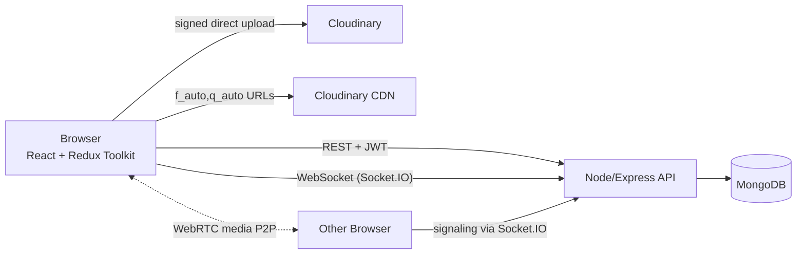

# Huddle — Interview Notes

> **Code:** `dev-aabhinav/project1`, branch `claude/huddle-mern-project-cgnc7q`, folder `server/`.
> **Reference (read-only, NOT my work):** `AadityanshuSingh/SocioSync`.
> **Rule:** every number here comes from something I actually ran in MY repo. Not run yet → **NOT MEASURED**.
>
> *Correction log:* an earlier version of this file described a Milestone 1 in a different repo
> (`Huddle-Real-Time-Social-Platform`). That code is not in `project1`, so it does not count.
> Milestone 1 was rebuilt from scratch in `project1` and everything below describes that build.

---

## 1. One-line pitch (30 seconds)

Huddle is a MERN social platform where users post, follow each other, chat in real time over
Socket.IO and make 1:1 video calls over WebRTC. I built it end to end — REST API with JWT auth,
React + Redux Toolkit frontend, Cloudinary image pipeline — and load-tested the chat server to find
its real capacity and first bottleneck. *(Status: Express foundation, MongoDB, User model and JWT auth (signup/login/me/change password,
19 automated tests) exist. Every capacity number: NOT MEASURED.)*

---

## 2. Architecture

> Status: **target design**. Built so far: Express server, `GET /api/health` (M1), MongoDB connection,
> User model, `GET /api/ready` (M2), JWT auth under `/api/auth` (M3).

**Data flow (target):** The browser calls REST endpoints with a JWT in the `Authorization` header;
middleware verifies it and the route reads/writes MongoDB. Chat messages go over a Socket.IO
connection (authenticated with the same JWT at handshake); the server **saves the message first, then
emits it** to the conversation's room and acks the sender. Images upload straight from the browser to
Cloudinary using a signature from our server, and are served through Cloudinary's CDN with
`f_auto,q_auto` transforms. Video calls use Socket.IO only to exchange SDP offers/answers and ICE
candidates; the audio/video flows peer-to-peer.

**Built so far (M1–M2):** `server.js`: `config/env.js` (load + validate all env) → register models →
`await connectDB()` (exit 1 if unreachable) → `createApp()` → `http.createServer(app)` → listen;
graceful shutdown closes HTTP first, then MongoDB. `app.js`: (trust proxy in prod) → json parser →
`/api/health` → `/api/ready` → `/api/auth` router → 404 → error handler (`toHttpError`).
Auth request path: rate limiter → `validate(zodSchema)` → [`requireAuth`] → controller.

---

## 3. Tech stack

| Tool | Layman meaning | Why used here | Alternative I didn't pick & why |
|---|---|---|---|
| Node.js 22 | Runs JavaScript outside the browser | One language front+back; event loop handles many idle connections (chat) well | Go/Java — better for CPU-heavy work, but second language + more boilerplate |
| Express 5.2.1 | The receptionist/router that sends each request to the right handler | Minimal, huge ecosystem; **v5 forwards async errors to the error handler automatically** (no try/catch in every route) | Express 4 (reference uses it; needs try/catch or wrapper everywhere); Fastify (faster, less familiar); NestJS (heavy) |
| dotenv 18 | Assistant who copies notes from the `.env` file into `process.env` | Local dev config without typing env vars every run; does nothing if no `.env` (production) | Node's built-in `node --env-file=.env` (Node ≥ 20.6) — fine too |
| nodemon 3 (dev only) | Auto-restarts server when I save a file | Dev convenience; in `devDependencies` so production never installs it | `node --watch` (built into Node) |
| CommonJS (`require`) | The older Node module style | Matches reference + most Express material | ESM (`import`) — modern standard; would also work |
| MongoDB 8 | A store-room with labelled shelves (collections) holding JSON-like documents | Document data (posts, messages, profiles) fits naturally; chat is append-heavy and partitions by conversation; the "M" in MERN | PostgreSQL — would also work well; better for heavy joins, transactions everywhere, strict relational integrity (follows/likes ARE relational) |
| Mongoose 9.12 | The store manager who checks every item against its printed form | App-level schema on a schemaless DB: types, required, maxlength, regex, defaults, timestamps, `select:false`; connection pool | Native MongoDB driver — less overhead but no schemas/validation; Prisma — typed, but Mongo support is less mature |
| mongodb-memory-server 11 (dev only) | Downloads a real `mongod` binary for local/test use | No MongoDB/Docker on the cloud dev box; used for automated tests from M3 | Docker `mongo:8` image (Docker not running here); Atlas for everything (needs network + account in tests) |
| MongoDB Atlas (deploy) | MongoDB hosted in the cloud | Free M0 tier, works with Render | Self-hosted Mongo on a VM — more ops work |
| bcrypt 6 | A deliberately slow fingerprint machine with a random salt per password | Password hashing; native, runs on libuv thread pool (doesn't block the event loop); cost 11 chosen from a benchmark | Argon2id — modern, memory-hard (resists GPUs better); bcryptjs — pure JS, blocks the event loop; SHA-256 — far too fast for passwords |
| jsonwebtoken 9 | The hotel key card with a hologram (signature) and expiry | Stateless signed tokens (HS256) that any of our servers can verify | Server-side sessions (Redis) — easy per-device logout, but a shared store on every request; `jose` library — modern, also good |
| zod 4 | The form checker at the entrance | Validates request bodies, strips unknown fields (mass assignment), normalises input, clear per-field errors | Joi / express-validator — similar; validating only in Mongoose — too late (can't validate the plain password) |
| express-rate-limit 8 | The bouncer with a notebook | Per-IP limits on login (10 failed/15 min) and signup (10/h); 429 + Retry-After | Redis-backed store (needed with many instances); Nginx/Cloudflare edge limits |
| Jest 30 + Supertest 7 (dev) | The robot inspector that re-checks everything | Real HTTP requests against the app without a port + a throwaway MongoDB per run | Vitest (faster, ESM-native); Mocha + Chai |
| React / Redux Toolkit | — | *(M10)* | — |
| Socket.IO | — | *(M8)* | — |
| WebRTC | — | *(M12)* | — |
| Cloudinary | — | *(M7)* | — |

---

## 4. Reference repo (SocioSync) vs my build

SocioSync is used only to see *what* to build. It has **no LICENSE**, so no code is copied; every
line in `project1` is written fresh. Its numbers/features do **not** count as mine.

**Reference endpoint count:** 23 routes, only 7 JWT-protected (not mine, just context).

| Area | SocioSync | My build | Why |
|---|---|---|---|
| Express | 4.18, try/catch in every controller | 5.2.1, one central error handler | async errors handled in one place |
| Structure | `index.js` builds app + listens | `app.js` (build) + `server.js` (listen) | tests use app without a port; Socket.IO attaches to `server` |
| dotenv / config | called too late in `index.js`, but also re-called in 4 other files → works by accident; `process.env` read everywhere | `config/env.js` is the **only** file that loads dotenv and reads `process.env`; validates all vars, reports all errors at once, exports a frozen object | single source of truth, fail fast, dotenv-order bug impossible by design |
| DB connect | `database.connect()` not awaited, server listens immediately; `process.exit(1)` inside the module | `await connectDB()` **before** `listen`; module throws, entry point exits; 5 s server-selection timeout | no requests before DB is ready; Render keeps old version if the new one can't connect |
| Password field | `password`, returned by every query; public `getallusers` leaks hashes | `passwordHash` with `select:false` **and** deleted in `toJSON` | defence in depth: careless query AND careless response both covered |
| Uniqueness | `unique` email but case-sensitive | `lowercase` + unique index on email and username | `A@x.com` and `a@x.com` can't both register; race-proof (DB enforces) |
| User shape | unbounded arrays (friends, requests, invites, chats, groups, saved) + separate Profile collection; `lastSeen: Date.now()` evaluated once; `activity`/`token` stored | no arrays (Follow/Message collections in M4/M6); profile fields embedded; `timestamps:true`; online status not stored | 16 MB limit, no hot document, one read per user, correct timestamps |
| PORT | `process.env.PORT \|\| 4000`, no validation | `\|\|` + regex digits-only + range check, crash if invalid | typos must fail loudly |
| 404 | none (Express HTML page) | JSON 404 | API always answers JSON |
| Errors to client | `error.message` sent even for 500s | 5xx → generic message, real error only in server log | don't leak internals |
| Shutdown | none | graceful SIGINT/SIGTERM + 10 s force-exit | deploys don't cut off requests |
| nodemon / react-icons | in server `dependencies` | nodemon in `devDependencies`; react-icons removed | smaller, safer prod install |
| `.vscode/` | committed | gitignored | personal editor config |
| `.env.example` | missing | committed | new dev knows which vars exist |
| OTP / signup | `sendotp` returns the OTP in the response (anyone can sign up as anyone; with `forgotpassword` = account takeover) | no OTP at all; plain signup with validated input | removes the hole; email verification noted as future work |
| Login messages | "User not registered" vs "Password is incorrect" + instant return for unknown emails | one message "Invalid email or password" + dummy bcrypt compare | no enumeration by text **or timing** (measured) |
| JWT | payload has email/id/userName, 48 h, secret unchecked, `console.log(decode)` in middleware | payload `sub` + `tv` only, 1 d, secret ≥ 32 chars validated, HS256 pinned on verify, nothing logged | readable tokens carry no personal data; `alg:none` blocked |
| Auth middleware | crashes on missing header (caught by accident), accepts any format, `req.user` = stale payload, deleted users still accepted | Bearer regex, verify, user must exist, `tokenVersion` must match, `req.user` = fresh DB user | revocation, fresh data, deleted-account detection |
| Change password | old tokens stay valid; email failure returns 500 with `success:true` after changing | re-auth with current password; one atomic update: new hash + `$inc tokenVersion`; fresh token returned | "log out everywhere" on password change |
| Validation | hand-written `if (!x)`, 403 for missing fields, `req.body.ultraNewSignupData.*` crashes if wrapper missing | zod schemas, 400 with per-field details, unknown fields stripped, strings only | correct status, no mass assignment, no NoSQL injection |
| Brute force | no rate limiting | 10 failed logins/15 min/IP, 10 signups/h/IP | caps guesses; protects bcrypt CPU budget |
| Tests | none (`"test": "echo Error"`) | 19 Jest + Supertest tests on a throwaway MongoDB | regressions caught automatically |

**Known problems in SocioSync we will NOT repeat (later milestones):** OTP returned in API response
(account takeover), public `getallusers` leaking password hashes, unprotected chat routes (read
anyone's chat / spoof sender), unauthenticated sockets (join any room), OTP TTL 16.7 h instead of
1 min (`expires` is in seconds), `default: Date.now()` evaluated once, `for…in` over arrays, client
saving messages instead of server, no pagination/indexes, uploads proxied through server, STUN only +
no ICE candidate queue.

---

## 5. Milestones

### Milestone 1: Hello server ✅

**What I built:** An Express 5 server with `GET /api/health`, a JSON 404 handler, a central error
handler, validated PORT, startup-error handling and graceful shutdown on SIGINT/SIGTERM. The app is
built by `createApp()` (no `listen`) so tests can import it without opening a port.

**Files created** (reference used: `sociosync/server/index.js`, `sociosync/server/package.json`, `sociosync/.gitignore`)
- `server/package.json` (+ `package-lock.json`, generated)
- `server/.gitignore`
- `server/.env.example`
- `server/src/app.js`
- `server/src/server.js`

**Line-by-line notes for tricky lines**
- `"private": true` → `npm publish` refuses to upload the package to the public npm registry.
- `"express": "^5.2.1"` → allows `5.2.1 ≤ v < 6.0.0` (5.2.0 ✗, 5.9.3 ✓, 6.0.0 ✗). Lockfile pins exact versions → reproducible installs (`npm ci`).
- nodemon in `devDependencies` → in prod it would NOT slow the app (never required); costs are bigger/slower installs and a bigger supply-chain attack surface.
- `.gitignore`: `.env` then `.env.*` then `!.env.example` → last matching rule wins; `!` un-ignores. A leaked secret stays in git history → must **rotate** it, deleting the file is not enough.
- `app.disable("x-powered-by")` → hides `X-Powered-By: Express` (minor hardening, not real security).
- `express.json({ limit: "100kb" })` → parses JSON body text into a JS object on `req.body`; > 100 kb → **413**; malformed JSON → **400**. Must be registered **before** routes (they read `req.body`).
- 404 handler registered **after** routes → only reached if nothing matched. At the top it would 404 everything.
- Error handler `(err, req, res, next)` → Express detects error middleware by **4 parameters**. Delete `next` → treated as normal middleware → never receives errors.
- `if (res.headersSent) return next(err)` → reply already started, can't send a new status; hand to Express's built-in final handler, which closes the connection. **Not a loop:** `next` only moves forward through the middleware array (index only increases). Verified with a demo: our handler ran exactly once.
- `status >= 500 ? "Internal server error" : err.message` → 5xx details (DB host, file paths) could be misused by attackers, so hidden; 4xx message tells the client what to fix. 5xx are logged with `console.error`; 4xx not (log flooding).
- `require("dotenv").config({ quiet: true })` on line 1 → a top-level `const X = process.env.Y` in any file takes a **copy at require time**; if dotenv runs later, `X` stays `undefined` forever (demo: `bad.js` printed `undefined` while `process.env` was already filled). dotenv never overwrites an existing env var and never converts types.
- `const rawPort = process.env.PORT || "5000"` → env vars are strings or undefined. Only `""` behaves differently between `||` and `??`. Old code used `??` → `Number("")` = 0 → server silently bound a **random port** (found by testing, fixed). `"0"` is a non-empty string → truthy → kept by both.
- `/^\d+$/.test(rawPort) || port > 65535` → validate the **raw string**; `Number(" ")` and `Number("")` are 0, too forgiving.
- `http.createServer(app)` instead of `app.listen()` → we need the `server` object for Socket.IO (M8) and `server.close()`.
- `server.on("error")` → without a listener, an `"error"` event crashes the process with a stack trace; now: one clear line + exit 1 (e.g. `EADDRINUSE`).
- `server.address().port` → real port (matters when `PORT=0`, OS picks one).
- `server.close(cb)` → stops new connections immediately; in-flight requests finish naturally; `cb` runs when all are done → `process.exit(0)`. `if (err)` in `cb` only fires if the server wasn't running — a defensive branch, almost never runs.
- `setTimeout(..., 10_000).unref()` → safety net only: force `exit(1)` if close hangs. 10 s is a **maximum**, not a wait. `.unref()` = the timer alone never keeps the process alive.
- `process.on("SIGINT"/"SIGTERM")` → replaces Node's default (exit immediately). SIGKILL cannot be caught.

**MEMORISE (facts about MY build)**
- Route: `GET /api/health` → `200 {status:"ok", uptimeSeconds, timestamp}`. Public. Liveness only.
- Error shape for every error: `{ "error": "<message>" }`.
- PORT default `5000`; invalid PORT (`" "`, `abc`, `5000.5`, `70000`) → exit 1 with message; empty PORT → 5000.
- Body limit 100 kb → 413. Malformed JSON → 400.
- Startup error (port taken) → `Failed to start server: listen EADDRINUSE...`, exit 1.
- Shutdown results I ran: normal SIGTERM → exit **0** immediately; stuck request → exit **1** after **10 s**.
- Versions: Node v22.22.0, Express 5.2.1, dotenv 18.0.5, nodemon 3.1.14.
- Middleware order: `express.json` → routes → 404 → error handler.

**UNDERSTAND**
- HTTP request (method, path, headers, body) / response (status, headers, body); 2xx ok, 4xx client mistake, 5xx server mistake.
- Node event loop: one thread + non-blocking I/O → good for I/O-bound, bad for CPU-bound.
- Middleware pipeline, `next()` vs `next(err)`, registration order.
- Truthy/falsy; `||` replaces any falsy value, `??` only `undefined`/`null`. Env vars → `||`; real data where 0/""/false are meaningful → `??`.
- 12-factor config; secrets only in env, never in git.
- Liveness vs readiness: liveness fails → restart; readiness fails → stop sending traffic.
- Graceful shutdown, signals (SIGINT, SIGTERM, SIGKILL), exit codes (0 success, non-zero failure — read by Render/Docker/CI).

**Interview questions**
- *Node is single-threaded — how does it serve 1000 concurrent requests?* → Event loop + non-blocking I/O (libuv/OS handle the waiting). → *Follow-up: when does it break?* CPU-bound work blocks everyone → worker threads / separate service / one process per core.
- *What is middleware, why does order matter?* → `(req,res,next)` pipeline, runs in registration order (parser before routes, 404 after). → *Follow-up: how is an error handler recognised?* 4 parameters.
- *Why split app.js and server.js?* → Tests use the app without a port; Socket.IO + `server.close()` need the `http.Server`. → *Follow-up: why not `app.listen`?* It hides the server object.
- *Health check returns 200 but users get errors — how?* → It proves only liveness: not DB, not other routes. → *Follow-up: should it check the DB?* No — slow DB would fail all instances → LB removes all → cascading outage. Use a separate readiness probe (M2) and watch real routes' error rate.
- *What happens to in-flight requests on deploy?* → SIGTERM → `server.close()` → in-flight finish → exit 0; 10 s timer → exit 1 if stuck. → *Follow-up: WebSockets?* Never finish on their own → close Socket.IO explicitly (M8), clients reconnect.
- *Tell me about a bug you found.* → Empty `PORT` + `??` → `Number("")` = 0 → random port, no error. Fixed: `||` + validate raw string.

**Scaling questions**
- *What breaks first at 100x?* → One Node process = one core (machine has 4). Detect: one core 100%, event-loop lag, p99 rising. Fix: one process per core (cluster/PM2) → more machines behind a load balancer.
- *Why can we scale horizontally?* → App is stateless (no user data in process memory). Breaks if we keep sessions / socket rooms / caches in memory → use JWT (M3) + Redis adapter (M13).
- *Can the health check cause an outage?* → Yes, if it depends on the DB (cascading failure) or is expensive and probed often.
- *1 lakh users?* → Rough estimate only: 1 lakh × 1 req/10 s ≈ 10k req/s → likely more than one process → per-core processes + several instances. **Capacity NOT MEASURED (M9).**
- *10 lakh users?* → DB becomes the bottleneck before Node: caching, read replicas, later sharding; many socket servers + Redis adapter.

**Honest weaknesses + fix**
- Liveness only, no readiness → **fixed in M2** (`GET /api/ready`).
- `console.error` instead of structured logs; no request logging → pino/morgan later.
- No `helmet`, CORS or rate limiting yet → M3/M13.
- Malformed-JSON 400 shows the parser's raw message → **fixed in M3** (`"Malformed JSON body"`).
- WebSockets will hold shutdown until the 10 s timeout → close Socket.IO first (M8).
- Second SIGTERM during shutdown prints the message twice and starts a second timer — cosmetic. *(I first claimed it would exit 1; tested it — wrong. The first close callback still exits 0, or the timer exits 1 if stuck.)*
- No automated tests yet → **fixed in M3** (19 tests).

### Milestone 2: MongoDB + config + User model + readiness ✅

**What I built:** One config module that loads and validates every env var at startup; a MongoDB
connection (awaited before the server listens, closed on shutdown); the `User` model with
case-insensitive unique email/username and a hidden password hash; and `GET /api/ready`, which
returns 503 when the DB is disconnected.

**Files created / changed** (reference: `sociosync/server/config/database.js`, `models/User.js`, `models/Profile.js`, `index.js`)
- `server/src/config/env.js` (new) — no reference equivalent
- `server/src/config/db.js` (new)
- `server/src/models/User.js` (new)
- `server/src/models/index.js` (new)
- `server/src/server.js`, `server/src/app.js`, `server/.env.example` (changed)
- deps: `mongoose` (runtime), `mongodb-memory-server` (dev)

**Line-by-line notes for tricky lines**
- `env.js`: the ONLY file that reads `process.env`; calls dotenv itself, so anyone importing `env` gets dotenv loaded first.
- `MONGODB_URI` has **no default**: a localhost default fails later with a misleading `ECONNREFUSED`; a real-cluster default would silently write production data into the wrong DB. Startup crash with "MONGODB_URI is required" is the feature.
- `errors.push(...)` then one `throw` → all config problems reported in one run (3 mistakes = 1 restart, not 3).
- `env.js` uses `throw`, not `process.exit(1)` → a module reports; only the entry point (owner of the process) exits. `process.exit` can't be caught and would kill a whole Jest run (demo: fake runner died, `try/catch` useless).
- `/^mongodb(\+srv)?:\/\//` → format check only; reachability is checked by `connectDB()`.
- `Object.freeze(env)` → config can't be changed at runtime by accident.
- `mongoose.set("bufferCommands", false)` → default Mongoose queues queries while disconnected (up to 10 s): users see spinners, hanging requests pile up, memory grows. We fail fast; readiness pulls the instance out.
- **Bug I hit:** with buffering off, Mongoose's automatic model `init` (create collection + indexes) ran before the connection existed → `TypeError ... reading 'createCollection'`. Mongoose source: `_waitForConnect` only waits `if (this._shouldBufferCommands())`. Fix: `autoCreate:false`, `autoIndex:false`, and `connectDB()` ends with `Promise.all(Object.values(mongoose.models).map(m => m.createIndexes()))`. Models must be registered first → `models/index.js` required before `connectDB()`.
- `connection.on(...)` listeners at top level → registered once. Inside `connectDB()` they'd be added on every call → duplicate log lines, listener leak, `MaxListenersExceededWarning`.
- `serverSelectionTimeoutMS: 5000` (default 30 000) → wrong URI / DB down reported in 5 s (measured: threw after 5.0 s).
- Log `host:port/name`, never the URI → Atlas URIs contain the password.
- `isDBReady()` = `readyState === 1` (0 disconnected, 1 connected, 2 connecting, 3 disconnecting) → in-memory, no query, cheap for frequent probes. Limit: reflects the driver's belief; a frozen DB / half-failed network can still read 1. Stronger: real `ping` with ~500 ms timeout, cached a few seconds.
- `unique: true` is an **index, not a validator**. Code check "find then insert" races: two signups both see "no user", both insert → two users with one email. Unique index → exactly one insert wins, other gets **E11000** (code 11000).
- `lowercase: true` on email/username → stored AND queried lowercase → case-insensitive uniqueness.
- `passwordHash` + `select:false` (stops careless queries) + deleted in `toJSON` (stops careless responses) = two layers.
- `toJSON.transform` → `_id` → `id` string, drop `__v` and `passwordHash`. `.lean()` returns plain objects, so `toJSON` doesn't apply there (but `select:false` still does).
- `timestamps: true` → per-document `createdAt`/`updatedAt` (fixes SocioSync's `default: Date.now()` evaluated once).
- `server.js`: `await connectDB()` before `listen`; on failure log + `exit(1)` (entry point). Shutdown: `server.close` → in-flight requests finish (may still need DB) → `disconnectDB()` → `exit(0)`. Reverse order would fail in-flight queries.
- `/api/ready` → **503** ("temporarily unavailable, route elsewhere"), not 500 ("unexpected bug").

**MEMORISE (facts about MY build)**
- Env vars: `NODE_ENV` (development|production|test, default development), `PORT` (default 5000), `MONGODB_URI` (required, `mongodb://` or `mongodb+srv://`).
- `GET /api/ready` → `200 {status:"ready", db:"connected"}` or `503 {status:"not ready", db:"disconnected"}`. Public.
- User fields: `name` (req, trim, ≤50), `username` (req, unique, lowercase, `^[a-z0-9_]{3,20}$`), `email` (req, unique, lowercase, ≤254, basic regex), `passwordHash` (req, `select:false`), `bio` (≤160, default ""), `avatarUrl` (default null), `createdAt`, `updatedAt`.
- Indexes on `users`: `_id`, `username_1` unique, `email_1` unique (verified).
- Mongoose options: `bufferCommands:false`, `autoCreate:false`, `autoIndex:false`, `serverSelectionTimeoutMS:5000`; pool = default **100** per process (deliberately not tuned yet — decide from the M9 load test).
- Observed (single run, not a benchmark): DB stopped → health 200, ready 503; DB restarted → ready 200 after **7 s** (driver heartbeat default every 10 s, `heartbeatFrequencyMS`). DB down at startup → exit 1 after ~5–6 s.
- Versions: Mongoose 9.12.1 (MongoDB driver 7.8.0), MongoDB server 8.2.6 (local), Node v22.23.4 in this container.
- Security maintenance: `npm audit` showed body-parser (high, DoS) + qs advisories → `npm audit fix` → body-parser 2.4.0, qs 6.17.1; `npm audit --omit=dev` = 0. Remaining: nodemon → minimatch (dev-only, not fixed: fix would downgrade nodemon).

**UNDERSTAND**
- Document DB vs relational DB; collections, documents, BSON, `_id`/ObjectId.
- ODM: why a schema on a schemaless DB.
- Indexes: B-tree, O(log n) lookup, unique index as atomic constraint; COLLSCAN vs IXSCAN (`explain()`).
- Embedding vs referencing: embed bounded + read-together data; separate collection for unbounded relationships.
- Connection pool; pool size × instances = DB connections.
- Fail fast (config, connection, buffering) vs waiting; liveness (restart) vs readiness (stop traffic).
- Module throws, entry point exits.

**Interview questions**
- *Why MongoDB, not SQL?* → Document-shaped data, append-heavy chat partitioned by conversation, MERN fit. Honest: follows/likes are relational; Postgres would work. → *Follow-up: when SQL?* Transactions everywhere, heavy joins/reporting, strict FK integrity.
- *Mongo is schemaless — why Mongoose?* → App-level schema, validation, defaults, timestamps, hiding fields. → *Follow-up: does validation run on `updateOne`?* No, only on `save/create`, unless `{ runValidators: true }` (use in M4 profile edit).
- *How do you guarantee unique emails?* → Unique index on lowercased email; code check races. → *Follow-up: what does the client see?* Catch 11000 → 409 Conflict (M3).
- *Why no followers array in User?* → 16 MB limit, every read drags it, hot document. Separate collection (M4). → *Follow-up: when is embedding right?* Bounded, read-together data (bio, avatar, settings).
- *Connection pool?* → Reused open connections; default 100/process. → *Follow-up: problem?* 20 instances × 100 = 2000 > Atlas free ~500 → set `maxPoolSize` ~15–20, watch Atlas metrics; then bigger tier, caching, read replicas, connection proxy.
- *Is `readyState === 1` a perfect readiness check?* → Cheap, but shows the driver's belief; frozen DB can still read 1. → Ping with ~500 ms timeout, cached a few seconds; keep `/api/health` dependency-free.
- *Tell me about a bug.* → `bufferCommands:false` broke automatic index creation (ran before connect); read Mongoose source; disabled autoCreate/autoIndex; build indexes explicitly after connect — now a failed unique index stops startup instead of failing silently.

**Scaling questions**
- *What breaks first now?* → The **database** (shared by all stateless Node instances). 10x: fine if indexed (COLLSCAN otherwise). 100x: connections + primary read load → smaller pools, Redis cache, read replicas. 1000x: write throughput/data size (chat) → sharding by a shard key (messages by `conversationId`).
- *Cost of read replicas?* → Eventual consistency: user updates bio, briefly reads old value from a lagging replica. OK for feeds, not for security-critical reads.
- *10 lakh users — is the users collection the problem?* → No: ~0.5 KB × 10 lakh ≈ 500 MB + indexes; email lookup O(log n) ≈ 20 B-tree steps. Load comes from messages/feeds and connection count. *(Back-of-envelope, NOT MEASURED.)*
- *How do you find a missing index?* → `explain("executionStats")`: COLLSCAN, docs examined ≫ docs returned; Atlas Performance Advisor.

**Honest weaknesses + fix**
- Readiness checks `readyState` only → add cached ping with short timeout.
- Indexes built on every startup → fine now; at scale build via deliberate migrations.
- Email regex is a sanity check; no email verification (OTP dropped) → verification link if needed.
- `maxPoolSize` untuned (default 100) → set from the M9 load test.
- Atlas on Render free tier needs network access `0.0.0.0/0` → only the DB password protects it; fix: static IPs / private networking on a paid tier.
- `heartbeatFrequencyMS` default → up to ~10 s before readiness recovers after a DB blip; lower = faster recovery, more background traffic.
- `.env` is gitignored, so a fresh clone/container has none → copy `.env.example` (happened in this project: fail-fast caught it).
- No automated tests yet → **fixed in M3** (19 tests).

### Milestone 3: Auth (signup, login, me, change password) ✅

**What I built:** JWT authentication: bcrypt-hashed passwords (cost chosen from a benchmark),
signed HS256 tokens with a `tokenVersion` claim for instant revocation, a `requireAuth` guard,
zod request validation, per-IP rate limits, a central error translator, and 19 automated tests
against a throwaway MongoDB.

**Files created / changed** (reference: `sociosync/server/controllers/Auth.js`, `middlewares/auth.js`, `routes/User.js`)
- `src/utils/httpError.js` — `HttpError` + `toHttpError` (no reference equivalent)
- `src/utils/jwt.js`, `src/utils/password.js`
- `src/middleware/validate.js`, `src/middleware/requireAuth.js`
- `src/validators/auth.schemas.js`
- `src/controllers/auth.controller.js`, `src/routes/auth.routes.js`
- `scripts/bench-bcrypt.js`
- `jest.config.js`, `tests/{globalSetup,globalTeardown,setupEnv,helpers}.js`, `tests/auth.test.js`, `tests/env.test.js`
- changed: `src/app.js`, `src/config/env.js`, `src/models/User.js`, `.env.example`, `package.json`
- deps: `bcrypt`, `jsonwebtoken`, `zod`, `express-rate-limit`; dev: `jest`, `supertest`

**Line-by-line notes for tricky lines**
- `class HttpError extends Error` + `super(message)` → real Error: stack trace (where it was thrown), `instanceof Error` works with Jest/loggers. A plain thrown object has `stack: undefined` (demo).
- `toHttpError`: `entity.parse.failed`→400, `entity.too.large`→413, Mongoose `ValidationError`→400 + `details[{field,message}]`, `CastError`→400, `code 11000`→409 `"<field> already exists"` (raw E11000 text hidden: DB/collection/index names), other `expose`d 4xx pass through, everything else → 500 generic. **Regression I caught:** without the 4xx pass-through, a 415 (bad charset) became 500 → client doesn't know to fix the request, our logs fill with fake bugs.
- Error handler logs the **original** error only when translated status ≥ 500.
- `jwt.sign({ tv }, secret, { algorithm:"HS256", subject: String(userId), expiresIn })` → payload only `sub`, `tv`, `iat`, `exp`. JWT is signed, NOT encrypted (decoded it in a demo) → no personal data.
- `jwt.verify(token, secret, { algorithms: ["HS256"] })` → pins the algorithm; `alg:none` and algorithm-confusion tokens rejected (tested). Tampered payload → `invalid signature`.
- `JWT_SECRET` ≥ 32 chars; production refuses the `.env.example` value. Length ≠ randomness → generate with `crypto.randomBytes(48)`.
- bcrypt hash anatomy `$2b$11$<22-char salt><31-char hash>` → salt + cost live inside the hash; same password hashed twice ≠ same string; `compare` reads salt/cost from the hash, constant-time.
- `Buffer.byteLength(plain, "utf8") > 72` → bcrypt silently ignores bytes after 72 (proved: 72 a's + anything matched 72 a's + anything else). Bytes ≠ chars ("€" = 3 bytes). Validation gives a 400; the check in `hashPassword` is a last guard (reaching it = our bug → 500).
- `tokenVersion: { default: 0, select: false }` + deleted in `toJSON`; password change does `$inc` (atomic) so old tokens fail `payload.tv === user.tokenVersion`.
- `validate(schema)`: `safeParse(req.body ?? {})` (Express 5: no body → `undefined`), errors → 400 `details`, **`req.body = result.data`** (without it the controller sees the raw body with attacker fields).
- `z.object` strips unknown keys → mass-assignment protection (`tokenVersion: 99`, `passwordHash` dropped — tested). Strings only → `{ "$gt": "" }` NoSQL injection rejected (400). `requiredString(label)`: missing → "is required", wrong type → "must be a string".
- Login schema: any non-empty password (policy may change; policy errors leak info). Signup/change: 8 chars to 72 bytes. Change: new ≠ current.
- `requireAuth`: regex `/^Bearer\s+(\S+)$/i` → `verify` in try/catch (else expired token → 500) → `isValidObjectId(sub)` (else CastError → 400) → `findById(sub).select("+tokenVersion")` → user exists && `tv` matches → `req.user` = fresh DB user. Five failures share one message "Invalid or expired token"; "Authentication required" only for no header.
- Login: `findOne({email}).select("+passwordHash +tokenVersion")`; unknown email → compare against a lazily created **dummy hash** (same cost; the **promise** is cached so concurrent requests share one hash) → same work, same time.
- Signup: hash → `User.create({ explicit fields })` → duplicate → E11000 → 409 (no find-first race) → **201** + token.
- Change password: re-auth with current password; wrong → **400 not 401** (401 would make the frontend log the user out); one `findOneAndUpdate` with `$set passwordHash` + `$inc tokenVersion`, `returnDocument:"after"` → fresh token for this device.
- Routes: limiter **before** `validate` (garbage requests count); login limiter `skipSuccessfulRequests:true` (only failures count), signup counts all (success is the expensive part); `handler` → `next(new HttpError(429))` for our JSON shape; `standardHeaders:"draft-8"` + `Retry-After`. `createAuthRouter()` is a function so each `createApp()` (each test) gets fresh counters.
- `app.set("trust proxy", 1)` only in production → real client IP behind Render's proxy; in dev it would let anyone fake `X-Forwarded-For`. Hop count still to be verified on the real deploy (M12).
- Tests: `setupFiles` set env before app code loads (`env.js` copies env at require time); one DB per Jest worker (`huddle_test_${JEST_WORKER_ID}`); `clearDB` = `deleteMany` (keeps unique indexes); `beforeEach` creates a fresh app (fresh limiter). `env.test.js` with `jest.isolateModules` only works because `env.js` **throws** instead of `process.exit`.
- **Bug I hit:** tests timed out; server said "Missing required sub-document 'driver'". Reproduced outside Jest → worked. Theory (BSON/Map across realms) tested and disproved. Raw driver also failed in Jest → not Mongoose/our code. Driver source: MongoDB driver 7.8 loads `os` via dynamic `import('os')`, which fails in Jest's VM sandbox. Fix: `node --experimental-vm-modules node_modules/jest/bin/jest.js` (works on Windows too). Rejected: driver's `@experimental` `runtimeAdapters` option in production code.

**MEMORISE (facts about MY build)**
- Endpoints: `POST /api/auth/signup` (201, 10/h/IP), `POST /api/auth/login` (200, 10 failed/15 min/IP), `GET /api/auth/me` (protected), `PATCH /api/auth/password` (protected).
- Response shapes: signup/login `{ user, token }`; change password `{ message, token }`; errors `{ error, details? }`.
- Statuses: 400 bad input / wrong current password, 401 bad credentials or token, 409 duplicate email/username, 429 rate limited.
- Env: `JWT_SECRET` (req, ≥32, not the example in prod), `JWT_EXPIRES_IN` (default `1d`, `^\d+[smhd]$`), `BCRYPT_ROUNDS` (default 11, 4–15, ≥10 in prod; tests 4).
- Token payload: `{ tv, iat, exp, sub }`, HS256, `exp − iat` = 86400 s.
- Password rules: 8 chars min, 72 bytes max.
- Versions: bcrypt 6.0.0, jsonwebtoken 9.0.3, zod 4.6.7, express-rate-limit 8.7.5, jest 30.5.2, supertest 7.3.2. `npm audit --omit=dev` = 0.
- Tests: 19 (15 auth, 4 env), all passing, ~1–1.5 s, stable over repeated runs.

**UNDERSTAND**
- Hashing vs encryption; salt; slow hashes and cost factors; rainbow tables; constant-time compare; timing attacks.
- JWT structure, signing vs encrypting, claims (`sub`, `iat`, `exp`), HS256 vs RS256, `alg:none`.
- Stateless tokens vs revocation (tokenVersion vs refresh tokens vs Redis denylist vs sessions).
- 400 vs 401 vs 403 vs 409 vs 429; user enumeration.
- Mass assignment, NoSQL injection, input validation layers (zod vs Mongoose).
- Rate limiting (fixed window, per-IP keys, NAT, proxies and `trust proxy`, per-instance memory).
- CPU-bound vs I/O-bound work; libuv thread pool; why more threads don't help CPU-bound work.
- Test isolation (fresh DB state + fresh app per test, DB per worker).

**Interview questions**
- *How do you store passwords?* → bcrypt cost 11 (benchmark: 71/143/282/569 ms for 10/11/12/13), random salt in the hash, >72 bytes rejected. → *Follow-up: why not SHA-256?* Too fast (GPU billions/s); bcrypt tunable/slow; Argon2id is the modern memory-hard choice.
- *JWT is stateless — logout / stolen token?* → `tv` claim vs DB `tokenVersion`, `$inc` on password change → instant 401 for old tokens; cost: one `_id` lookup per request. → *Follow-up: alternatives?* Short access + refresh tokens (no lookup, ≤15 min exposure, more complexity); Redis denylist (instant, sub-ms, extra infra).
- *Why JWT if you hit the DB anyway?* → Signature rejects forged/expired tokens before any DB work; no session store to run; same Bearer token for REST and Socket.IO; easy path to pure stateless (cache `tv` in Redis). Sessions would give per-device logout and opaque cookies, but need a shared store and CSRF handling.
- *User enumeration?* → Same 401 text + dummy hash; measured 146.7 ms vs 146.2 ms (naive: 149.5 vs 2.3 ms). → *Follow-up: signup?* 409 leaks; accepted trade-off + signup rate limit.
- *JWT attacks?* → Tampering (HMAC), `alg:none`/confusion (pinned HS256), weak secret (≥32, prod check), data exposure (minimal payload). → *Follow-up: RS256?* When many services verify but must not issue.
- *Brute force?* → 10 failed/15 min/IP, 429 + Retry-After, `trust proxy` in prod. → *Follow-up: weaknesses?* Shared IP/NAT locks everyone (key IP+email, CAPTCHA); per-instance memory (Redis store).
- *Trace POST /api/auth/login with a wrong password.* → http.Server → json parser → health/ready skipped → /api/auth router → loginLimiter → validate → controller (findOne, bcrypt ~143 ms, false, throw HttpError 401) → Express 5 forwards rejection → error handler (not logged) → `401 {"error":"Invalid email or password"}` + RateLimit headers; the 11th failure → 429 before validation.

**Scaling questions**
- *What's different now?* → First CPU-bound endpoint: login/signup throughput = cores ÷ hash time. Measured ~54/s (cost 10) and ~13.6/s (cost 12) on 4 vCPU; **derived** ~28/s at cost 11. Threads 4 vs 8 made no difference.
- *500 logins/s?* → 500 ÷ 28 ≈ 18 instances at 100% CPU, ≈ 26 at a 70% target, bcrypt alone (derived). Also breaks: per-instance rate limits (≈26× the limit; Redis store), DB connections (26 × 100 pool = 2,600 > Atlas free ~500; set maxPoolSize ~15–20), plus `requireAuth` reads on the primary and event-loop lag on busy instances.
- *Morning storm, 1 lakh logins in 10 min?* → ≈167/s → ≈6 instances for bcrypt alone (derived); autoscale, longer sessions, lower cost only as last resort.
- *requireAuth at 10k req/s?* → 10k `_id` reads/s on the primary → cache user + `tokenVersion` in Redis (short TTL; revocation delayed up to TTL) or read replicas.
- *JWT across many servers?* → Same secret on all instances; rotation via `kid` header accepting old + new keys during the switch; RS256 if separate services verify.

**Honest weaknesses + fix**
- Access token lives 1 day; no refresh tokens → short access + rotating refresh tokens.
- Only "log out everywhere", no per-device logout → per-session ids in the token + a session list.
- Per-IP limits break behind NAT (whole hostel locked out; correct password also got 429 while limited) → key IP+email, CAPTCHA, per-account lockout + notification.
- Rate-limit counters in process memory → Redis store for multiple instances.
- No rate limit on `PATCH /password` (a stolen token could brute-force the current password at bcrypt speed) → per-user limiter.
- Signup reveals that an email exists (409) → accepted trade-off; verification-email flow if needed.
- No email verification / password reset (OTP dropped).
- 401s don't include `WWW-Authenticate: Bearer`.
- Token failures aren't logged → structured logging (pino) with reason codes server-side only.
- Signup hashes before discovering a duplicate (wastes ~143 ms CPU) → acceptable; a pre-check is still racy.
- Tests need `--experimental-vm-modules` (prints an ExperimentalWarning) because of the driver's dynamic `import()`.
- `trust proxy` hop count unverified until the real Render deploy (M12).

---

## 6. Endpoints (source of truth for the "N endpoints" claim)

| # | Method | Path | Protected? | Milestone |
|---|---|---|---|---|
| 1 | GET | `/api/health` | No | M1 |
| 2 | GET | `/api/ready` | No | M2 |
| 3 | POST | `/api/auth/signup` | No (rate limited 10/h/IP) | M3 |
| 4 | POST | `/api/auth/login` | No (rate limited 10 failed/15 min/IP) | M3 |
| 5 | GET | `/api/auth/me` | **Yes** | M3 |
| 6 | PATCH | `/api/auth/password` | **Yes** | M3 |

**Count so far: 6 (2 protected).** Resume claim "25+": **NOT YET TRUE.**

---

## 7. Benchmarks

Machine specs must be captured **at the time of each benchmark**
(the cloud container changes between sessions — CPU seen as 4 vCPU Xeon @ 2.80 GHz in one session and
@ 2.10 GHz in another, 15 GiB RAM; Node v22.22.0 in one container, v22.23.4 in a later one).

| Metric | Value | Conditions |
|---|---|---|
| Endpoint count | 6 (in progress) | Counted from §6 |
| bcrypt hash time, median (p95) | cost 10: 71.0 (74.5) ms · 11: 142.8 (158.4) ms · 12: 282.0 (295.6) ms · 13: 568.5 (585.9) ms | `scripts/bench-bcrypt.js`; 20 timed hashes per cost after 2 warm-up; wall clock around one `bcrypt.hash()` (includes thread-pool hand-off, excludes HTTP/DB); 4 vCPU Intel Xeon @ 2.10 GHz, 1 thread/core, 15 GiB, Node v22.23.4, bcrypt 6.0.0; one run per config on a shared cloud VM |
| bcrypt throughput (N concurrent) | cost 10: ~54/s · cost 12: ~13.6/s (N = 4, 8, 16); same with UV_THREADPOOL_SIZE=8 | same script/machine; N hashes via `Promise.all`; throughput = N ÷ wall time. Cost 11 throughput **not measured** (derived ≈ 4 ÷ 0.143 s ≈ 28/s) |
| Login timing, existing vs unknown email (wrong password) | ours: 146.7 ms vs 146.2 ms · naive (no dummy hash): 149.5 ms vs 2.3 ms | 15 HTTP requests per case, median, localhost, BCRYPT_ROUNDS=11, same machine; includes HTTP + validation + DB lookup + bcrypt |
| Chat p50/p95/p99 delivery latency @ N connections | NOT MEASURED | M9 |
| Chat error rate | NOT MEASURED | M9 |
| Call setup time (median / worst) | NOT MEASURED | M12 |
| Image payload reduction | NOT MEASURED | M7 |

---

## 8. Scaling section

- Current capacity of one instance: **NOT MEASURED** (M9).
- Bottlenecks at 10x / 100x / 1000x: to be filled from the real load test.
- Scaled architecture diagram: M14.

---

## 9. Resume lines (draft — only claims backed above may stay)

- ~~25+ RESTful endpoints~~ → currently 6 (2 protected by JWT). NOT YET TRUE.
- Usable now (backed by §5 M3 + §7): "JWT auth with bcrypt (cost tuned by benchmark), token revocation, rate limiting and timing-safe login; 19 automated tests."
- ~~Real-time chat, 500 connections, p95 ~45 ms~~ → NOT BUILT / NOT MEASURED.
- ~~WebRTC calling, median setup ~1.2 s~~ → NOT BUILT / NOT MEASURED.
- ~~Redux Toolkit; Cloudinary ~70% payload cut~~ → NOT BUILT / NOT MEASURED.
