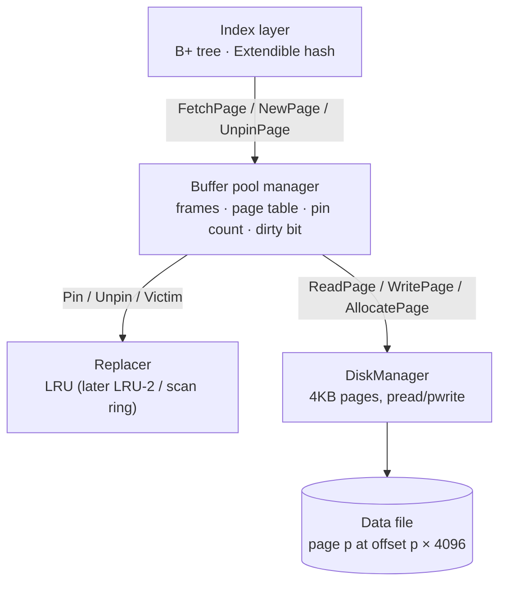

# Disk-Backed Index Engine — Interview Notes

Repo: `dev-aabhinav/project3` · C++17 · CMake · GoogleTest

---

## One-line pitch (30 seconds)

A single-threaded C++17 storage engine that stores data in 4KB pages on disk,
caches them in a buffer pool with pin counts and an O(1) LRU replacer, and
builds two disk-backed indexes on top: a B+ tree (point + range queries) and
extendible hashing (point queries). I benchmarked both against the STL
containers, warm and cold, and ran a sequential-flooding experiment on the
buffer pool. *(Benchmark numbers: NOT MEASURED yet.)*

---

## Architecture



**A lookup's journey (target design; built up milestone by milestone):**
The B+ tree asks the buffer pool for the root page id. The pool checks its
page table (page id → frame). On a hit it pins the frame and returns it; on a
miss it asks the replacer for a victim frame (only unpinned frames are
candidates), writes the victim back if dirty, then has the DiskManager read
the wanted page into that frame. The tree binary-searches the node, finds the
child page id, unpins the current page and repeats until it reaches a leaf.

---

## Tech stack / concept table

| Concept | Layman meaning | Why used here | Alternative I didn't pick, and why |
|---|---|---|---|
| Fixed 4KB pages | Register book where every page is the same size | Matches OS page + filesystem block; offset = id × 4096 | 8KB/16KB (Postgres/InnoDB): higher fanout but more waste per point read; 4KB is simplest |
| `pread` / `pwrite` | "Read at this exact position" in one call | No shared file cursor, no lseek race, one syscall | `fstream`: extra user-space buffering, double copy; `mmap`: OS controls eviction, no control over write-back order (bad for a DB) |
| OS page cache (no `O_DIRECT`) | The kernel quietly keeps file data in RAM | Simple, free read-ahead | `O_DIRECT`: avoids double caching, needed for honest "cold" numbers, but needs aligned buffers |
| CMake + FetchContent | Build recipe that downloads its own test library | Reproducible on a fresh cloud box or laptop | Makefile: not portable; system-only GTest: breaks on fresh machines |
| GoogleTest fixtures | Fresh table setup before each test | Each test gets its own file, no cross-test leakage | Catch2: also fine; GTest is the industry default |
| ASan + UBSan build | A watchman for memory bugs | We `memcpy` into raw 4KB buffers; catches overflow/use-after-free | Valgrind memcheck: slower (~20–50x) |
| LRU = `std::list` + `unordered_map<key, list::iterator>` | Study table with 3 slots; return the book untouched longest | O(1) get/put; the classic interview version | Single `unordered_map` + timestamps: eviction becomes O(n) scan (or O(log n) with a heap/set) |
| Stress test vs brute force | Same as CP: compare fast solution with obviously-correct slow one on random input | Catches ordering bugs hand tests miss (caught a missing `splice` at op 81) | Only hand-written tests: miss rare interleavings |
| Replacer as array-based doubly linked list (`prev[N]`, `next[N]`) | Same LRU list, but stored in two fixed int arrays like a CP adjacency list | No malloc after startup, small cache-resident arrays, O(1) Pin/Unpin/Victim | `std::list`: malloc per node + pointer chasing; CLOCK: one bit per frame and cheaper hits, but Victim may scan many frames |
| Replacer holds only unpinned frames | Only books nobody is reading go on the "send back" list | Victim never skips pinned frames → O(1) | Keep all frames and skip pinned ones: O(N) worst case per eviction |
| Buffer pool with write-back | Reading room: N desks, a register, reader counts, "notes written" flag | Many changes to a page cost one disk write (at eviction/flush); hits cost zero I/O | Write-through (write to disk on every change): simpler, crash-safer, but one I/O per modification |
| Fail fast when all frames pinned (`BufferPoolFullError`) | "No desk free", said immediately | Single-threaded: nobody else can ever unpin, so waiting = hang forever | Block and wait for an unpin: needed with many threads, but risks deadlock |
| `mmap` instead of a buffer pool (not picked) | Let the OS manage the reading room | — | OS decides eviction and write-back order (can't guarantee WAL-before-data), I/O stalls appear as page faults, no pin control. See Crotty et al., "Are You Sure You Want to Use MMAP in Your DBMS?" (CIDR 2022) |
| RAII `PageGuard` (move-only) | Library card that signs you out automatically, whichever door you leave by | Unpin happens in the destructor → no pin leaks on early return or exception | Manual Unpin calls: easy to forget on one of many exit paths |
| B+ tree (fanout 340) instead of a BST | A BST with ~300 children per node | 1M keys in ~3 levels = ~3 page reads, vs ~20 for a binary tree | Balanced BST / skip list: fine in RAM, terrible on disk (one page read per level) |
| Separate `keys[]` and `values[]` arrays in a leaf (struct of arrays) | Keep the index cards in one drawer, the contents in another | Binary search touches only keys: 8 keys per 64-byte cache line instead of 4 pairs | Array of (key, value) pairs: simpler, worse locality during search |
| `reinterpret_cast` raw page bytes to node structs | Read the page "as if" it were a struct | Zero-copy, same as BusTub; `static_assert` checks size + standard layout | `memcpy` in/out or C++23 `std::start_lifetime_as`: strictly standard-safe; costs copies / newer compiler |
| Path stack instead of parent pointers | Remember the corridors you walked down, instead of every room storing "my parent is…" | After an internal split ~170 children move; parent pointers would need ~170 page writes | Parent pointers: easy upward walk, expensive splits/merges |
| Split point: left gets ceil((n+1)/2) | Cut the folder roughly in half | Both halves ≥ half full → balanced occupancy | Ascending-insert optimisation (split 90/10 or "append" split, like InnoDB/Postgres fastpath): ~100% fill for sequential keys instead of 50% |
| Delete with borrow-then-merge, min occupancy ceil(max/2) | A folder that gets too empty borrows a card from its neighbour, or the two folders are combined | Keeps every node ≥ half full → height stays O(log n), space stays bounded | "Lazy" delete without merging (many real systems, e.g. Postgres B-tree never merges non-empty pages; frees only empty ones): simpler, no rebalancing cascades, but space can stay wasted after mass deletes |
| Range scan via leaf-chain iterator | Find the first page once, then read pages in order | One descent + sequential leaf walk; holds one pin | Repeated point lookups per key: one full descent per key |
| Extendible hashing | Post office: mailbox chosen by the last few PIN digits; an overflowing box splits by looking at one more digit | Grows one bucket at a time: no full rehash (which on disk = rewrite the whole file) | Linear hashing: splits buckets in round-robin order, no directory, smoother growth, but needs overflow chains; static hashing + full rehash: long pauses |
| Mixing hash (splitmix64 finalizer) instead of `std::hash` | Shuffle the digits so similar PINs don't land in the same box | libstdc++ `std::hash<int64>` is identity; patterned keys share low bits → directory explodes (measured: depth 13 vs 4) | Identity hash: fast, but terrible on patterned keys; cryptographic hash: unnecessary cost |
| Multi-page directory (1024 ids/page) + cached meta page | The directory is a long list spread over several pages | Lets global depth reach 19 (≈133M keys); lookup = 2 page reads | Directory in one page: max depth 9 (512 buckets ≈ 130k keys) — too small for 1M; BusTub-style header→directories→buckets: bounds each directory to one page |

---

## Machine specs (cloud container, recorded 2026-10-05)

- `nproc`: 4
- CPU: Intel Xeon @ 2.80GHz (family 6 model 85, Cascade Lake), KVM guest, 1 thread/core
- Caches: L1d 128 KiB (4 × 32K), L2 4 MiB (4 × 1M), L3 33 MiB
- RAM: 15 GiB, no swap
- Compilers: g++ 13.3.0, clang++ 18.1.3; CMake 3.28.3; GoogleTest 1.14
- **perf: hardware counters NOT available** (`dmesg`: "no PMU driver, software
  events only"). Cache-miss numbers must come from my laptop (real) or
  cachegrind (simulated, labelled as such).

**Machine specs, second container (recorded 2026-11-15, used for M6 tree-shape run):**
- `nproc`: 4; Intel Xeon @ 2.30GHz, KVM guest
- Caches (as reported by the VM): L1d 192 KiB (4 instances), L2 8 MiB (4 instances), L3 504 MiB
- RAM: 15 GiB
- The container hardware CHANGES between sessions → always re-record specs next to timing numbers.

---

## Milestones

### Milestone 1: Project skeleton + DiskManager

**What I built:** a CMake project (static library `index_engine` + GoogleTest
binary `unit_tests`) and a `DiskManager` that reads/writes whole 4KB pages
to one file with `pread`/`pwrite`, allocates page ids, and recovers its page
count when the file is reopened.

**Plain-language version (say this first)**
A database must remember data after the program closes, so it lives in a file.
A file is just one huge `char` array on disk, and disk is ~1000x slower than RAM,
so we move it in fixed blocks of 4096 bytes (like sqrt-decomposition blocks).
Page p = bytes `[p*4096, p*4096 + 4095]` (page 3 = bytes 12288..16383).
`ReadPage`/`WritePage` = memcpy one block between disk and a RAM buffer.

**MEMORISE**
- `kPageSize = 4096` (`include/index_engine/config.h`)
- `page_id_t = int32_t`, `kInvalidPageId = -1` → max 2³¹ pages × 4KB = 8 TB per file
- Class `DiskManager` (namespace `index_engine`):
  `ReadPage(page_id, char* out)`, `WritePage(page_id, const char* data)`,
  `AllocatePage()`, `Sync()` (fsync), `NumPages()`, `NumReads()`, `NumWrites()`
- Offset = `static_cast<off_t>(page_id) * 4096` — cast **before** multiplying
  (int32 × 4096 overflows at page 524,288 = 2 GB)
- Open flags: `O_RDWR | O_CREAT`, mode `0644`; no `O_DIRECT`
- Reopen: `num_pages = file_size / 4096` via `fstat`
- Unwritten-but-allocated page reads back as zeros (EOF → `memset`)
- Copy constructor/assignment deleted (owns an fd → Rule of Three)
- Default build type Release; `-DENABLE_SANITIZERS=ON` gives ASan + UBSan
- 6 tests: NewFileHasNoPages, AllocateReturnsSequentialIds,
  WriteThenReadRoundTrip, UnwrittenPageReadsAsZeros, DataSurvivesReopen,
  InvalidPageIdThrows

**UNDERSTAND**
- Why fixed-size pages: devices/OS move blocks anyway; trivial offset math.
- Short reads/writes: syscalls may move fewer bytes than asked → loop; `EINTR` → retry.
- `pwrite` returning ≠ durable. Process crash: data safe in kernel cache.
  Power loss: can be lost. Only `fsync` guarantees it reached the device.
- OS page cache = second cache under our future buffer pool ("double buffering").
- Torn pages: a 4KB write is not atomic on power loss → checksums + WAL full-page
  writes (Postgres) or doublewrite buffer (InnoDB).
- Why the DiskManager doesn't cache: single responsibility; one place to count real I/O.

**Complexity**
- `ReadPage` / `WritePage`: O(1) syscalls, O(page size) bytes copied
- `AllocatePage`: O(1) (counter increment; file grows lazily on first write)
- Space: O(1) in memory; file = num_pages × 4KB

**Interview questions**
- Why 4KB? → OS page + FS block size, one page = one block. → *Follow-up:* when 8/16KB? Higher fanout for range scans/SSD, more waste per point read, worse torn writes.
- Why pread/pwrite? → explicit offset, one syscall, no shared cursor. → *Follow-up:* short reads? Loop until 4096 bytes; retry on EINTR.
- Is data on disk after WritePage? → No, OS cache; needs fsync. → *Follow-up:* why not fsync every write? Too slow; real DBs fsync the WAL at commit, flush data pages lazily.
- Why no caching here? → buffer pool's job. → *Follow-up:* double caching with OS cache? Yes; InnoDB uses O_DIRECT to avoid it.
- Crash-safe? → No: torn pages possible. → *Follow-up:* fix? Checksums + WAL full-page images / doublewrite.

**Scaling questions**
- 1M → 1B keys? → ~16 GB raw, ~25 GB with tree overhead; int32 ids fine (8 TB). RAM runs out first: OS cache can't hold the file, reads go from ~1 µs (cached) to ~100 µs (SSD). Detect via `NumReads()`, `iostat`. Fixes: bigger pool → O_DIRECT + own pool → io_uring async I/O → sharding.
- Many threads? → pread/pwrite are thread-safe, but `num_pages_++` and counters race → `std::atomic`; then device queue depth is the limit (io_uring).
- File bigger than one disk? → segment files (Postgres 1 GB segments) or partition across machines.

**Honest weaknesses + fixes**
- No free list: deleted pages never reused, file only grows → keep a free-page list (or bitmap) persisted in a header page.
- Allocated-but-never-written trailing pages are forgotten on reopen (count comes from file size) → persist `num_pages` in a header page.
- No `O_DIRECT`: "cold" pool reads may still come from OS cache → state this in every cold benchmark, or use O_DIRECT / drop caches.
- No checksums, no torn-page detection → CRC32 per page header.
- Not thread-safe (counter races).

### Milestone 2: LRU cache (textbook version)

**What I built:** a generic header-only `LRUCache<K, V>` with O(1) `Get` and
`Put`, using `std::list` (recency order) + `std::unordered_map` (key → list
iterator) + `splice`. It is the interview version; the buffer pool will NOT
use it (see weakness below and M3).

**Plain-language version (say this first)**
Study table with room for N books. Using a book moves it to the "most recent"
end. Table full and you need a new book → send back the one untouched longest.
The map finds a book instantly; the linked list remembers the order and can
move any book to the front instantly, once the map has told you where it is.

**MEMORISE**
- File: `include/index_engine/lru_cache.h` (header-only template, no .cpp)
- `std::list<std::pair<K,V>> items_` — front = most recent, back = victim
- `std::unordered_map<K, list::iterator> index_` — `reserve(capacity)` in constructor (no rehash pauses)
- `std::optional<V> Get(const K&)` — returns `nullopt` on miss (not `-1`, which could be a real value)
- `void Put(const K&, const V&)` — update+refresh if present; else evict back if full, `emplace_front`
- Hit/update: `items_.splice(items_.begin(), items_, it)` — relinks the node, no copy, no allocation, iterator stays valid
- Evict order: read `items_.back().first` → `index_.erase(key)` → THEN `items_.pop_back()` (reverse order = use-after-free)
- Key is stored inside the list node too, so eviction knows which map entry to erase
- Capacity 0 throws `std::invalid_argument`
- 8 tests incl. stress test: 200,000 random ops, capacity 16, 40 keys, seed 12345, vs O(n) vector brute force
- Mutation check: removing `splice` in `Get` → 2 tests fail (stress test at op 81)

**UNDERSTAND**
- Why two structures: map gives O(1) find but no order; list gives O(1) move/remove but O(n) find.
- Why a *doubly* linked list: removing a node from the middle needs its prev pointer.
- Why `splice` beats erase + push_front: no free/malloc, and the iterator held by the map stays valid.
- `Get` is a *write* to the structure (it reorders) → matters for threading.
- **Why `std::list` is slow (pointer chasing):** every node is a separate heap
  allocation at a random address. Walking/touching nodes means each step is a
  likely cache miss (~100 ns to RAM vs ~1 ns L1). A vector's elements sit side by
  side, so one 64-byte cache line brings several of them at once. Plus one
  malloc/free per insert/evict.
- **What a real buffer pool uses instead:** number of frames N is fixed at startup,
  so keep `prev[N]`, `next[N]` integer arrays indexed by frame id (an "intrusive"
  list with indices as pointers). No allocation ever, contiguous memory, 4–8 bytes
  per link. Built in M3.

**Mistakes I made in the checkpoint (don't repeat)**
- A `Get` miss does NOT insert the key: it returns `nullopt` and the list is unchanged.
  (In the buffer pool, the *caller* loads the page and inserts it.)
- Vector is not slow at *reading*; it is slow at *moving a middle element to an end* (O(n) shift).

**Complexity**
- `Get`: O(1) average (hash lookup + splice)
- `Put`: O(1) average (hash lookup/insert/erase + list ops)
- Space: O(capacity). Per entry: a list node (2 pointers + pair + malloc header)
  plus a hash node and bucket slot. Overhead per entry is several times the size
  of a small int pair — exact bytes NOT MEASURED.

**Interview questions**
- Why map + list? → map finds in O(1), list keeps order with O(1) move. → *Follow-up:* why store the key in the node? To erase the evicted key from the map.
- Why `splice`? → moves the node in O(1) without allocating; iterators stay valid. → *Follow-up:* what breaks if you used `erase` + `push_front`? The map's stored iterator dangles unless you update it; plus an extra free + malloc.
- Write LRU live (LeetCode 146). → get: find → miss? / splice → return; put: exists? update+splice : (full? erase map(back.key), pop_back) → emplace_front, map[key]=begin.
- Is it thread-safe? → No. Even `Get` mutates the list, so a reader-writer lock doesn't help; it needs an exclusive lock. → *Follow-up:* scale it? Shard by `hash(key) % S`, each shard its own lock + LRU (RocksDB's sharded LRU cache); or CLOCK, where a hit just sets a bit.
- Weakness of LRU itself? → one big sequential scan pushes out all hot items ("sequential flooding"). → *Follow-up:* fix? LRU-2 / scan-resistant ring buffer (M13).

**Scaling questions**
- 1000x more entries? → memory overhead and malloc per insert dominate; pointer chasing means each touch is a cache miss. Fix: pre-allocated arrays with index links (M3), or CLOCK (one bit per slot).
- Many threads? → one global lock, and every `Get` needs it exclusively → lock contention. Detect: throughput flat or falling as threads increase. Fixes, cheapest first: shard into S independent LRUs → CLOCK (hits only set a bit, almost no locking) → lock-free designs. What gets harder: no single global LRU order any more, only approximate LRU per shard.

**Honest weaknesses + fixes**
- Heap allocation per node + pointer chasing → index-based frame arrays (M3).
- Not thread-safe → sharding or CLOCK.
- Pure LRU is not scan-resistant → LRU-K / ring buffer (M13).

### Milestone 3: LRU Replacer (buffer-pool version)

**What I built:** `LRUReplacer`, which tracks only the *unpinned* buffer-pool
frames in LRU order and returns the least recently unpinned one in O(1). The
list is stored in pre-allocated `prev_`/`next_` arrays indexed by frame id,
with no heap allocation after construction.

**Plain-language version (say this first)**
Same study table, new rule: a book someone is reading (pinned) can't be sent
back. So the "send back" list only contains books nobody is reading. When I
need a seat, I take the oldest book from that list, with no checking needed.

**MEMORISE**
- Files: `include/index_engine/lru_replacer.h`, `src/lru_replacer.cpp`
- `frame_id_t = int32_t`, `kInvalidFrameId = -1` (frame = RAM slot 0..N-1; page = disk block)
- API: `Unpin(f)` → add as most recent (no-op if already present);
  `Pin(f)` → remove (no-op if absent); `Victim()` → remove + return tail, `nullopt` if none; `Size()`
- Storage: `std::vector<frame_id_t> prev_, next_` (sized once, never grow),
  `std::vector<uint8_t> in_list_` (not `vector<bool>`: packed bitset), `head_` = most recent, `tail_` = victim
- Design choice: Unpin of an already-evictable frame keeps its old position
- No loops anywhere → every operation O(1)
- 10 tests incl. stress test (64 frames, 200,000 random Pin/Unpin/Victim, seed 777, vs `std::list` linear-scan reference)
- Mutation check: deleting `tail_ = p` in `Unlink` → 6 tests fail

**UNDERSTAND**
- Pin = "in use, must not be evicted"; pin count > 0. Replacer only sees pin count == 0 frames.
- Why only unpinned frames in the list: Victim is the tail, never needs to skip pinned frames → O(1).
- Unlink(f): `next[prev] = next`, `prev[next] = prev`, plus head/tail edge cases.
- Why arrays beat `std::list`: no malloc/free, compact (N=1000 → 8 KB of links, fits in L1/L2),
  4-byte indices vs 8-byte pointers. Honest caveat: `next[i]` can still jump anywhere in
  the array, so the win is no allocation + tiny cache-resident arrays, not perfect sequential access.
- `frame_id_t` and `page_id_t` are both plain `int32_t` aliases: compiler won't catch mixing them
  (a strong-typedef struct would).

**Complexity**
- `Unpin`, `Pin`, `Victim`: O(1) worst case (not just average: no hashing)
- Space: O(N) for N frames, ~9 bytes per frame (two int32 links + one byte flag), allocated once

**Interview questions**
- Why does the replacer hold only unpinned frames? → so Victim is O(1) and never returns a frame in use. → *Follow-up:* what if all frames are pinned? Victim returns `nullopt`; the buffer pool must fail fast (error), not loop/wait.
- How is your LRU list stored? → `prev[]`/`next[]` int arrays indexed by frame id. → *Follow-up:* why not `std::list`? malloc per node + pointer chasing.
- Why not CLOCK? → CLOCK makes hits cheaper (just set a bit, no relinking, good for concurrency) but eviction may sweep many frames; LRU here is exact and O(1). → *Follow-up:* what do real DBs use? PostgreSQL uses clock-sweep; InnoDB uses a modified LRU with a midpoint insertion (old/young sublists) to resist scans.
- Why `vector<uint8_t>` not `vector<bool>`? → `vector<bool>` is a packed bitset specialization: bit masking on every access, no real `bool&`.
- Unpin on an already-evictable frame? → design choice: no-op, keeps position.

**Scaling questions**
- 1000x more frames (e.g. 1M frames = 4 GB pool)? → arrays are ~9 MB, still fine; O(1) ops unchanged. The pool's page table (page→frame hash map, M4) grows more. Pure LRU's weakness under scans matters more with big scans (M13).
- Many threads? → every Pin/Unpin modifies the shared list → one latch → contention on every page access. Fixes: partitioned pools (hash page id → sub-pool, each with own replacer + latch) → CLOCK (hits just set a reference bit) → lock-free variants. What gets harder: eviction becomes approximate / per partition.

**Honest weaknesses + fixes**
- Not thread-safe → latch per partition or CLOCK.
- Exact LRU is not scan-resistant → LRU-K / scan ring buffer (M13).
- Weak type safety between frame ids and page ids → strong typedef structs.

### Milestone 4: Buffer Pool Manager

**What I built:** `BufferPoolManager`, which caches disk pages in a fixed
number of 4KB frames. It tracks page id → frame in a page table, uses never-used frames
first, then evicts the LRU unpinned frame (writing it back first if dirty),
keeps pin counts and dirty flags, and throws `BufferPoolFullError` immediately
when every frame is pinned.

**Plain-language version (say this first)**
Library reading room with N desks. A register says which book is on which desk.
Each desk tracks how many people are reading (pin count) and whether someone
wrote notes (dirty). Asked for a book: if it's on a desk, hand it over (hit, no
basement trip). If not: take an empty desk, else clear the least-recently-used
desk nobody is reading; if that book has notes, copy it back to the basement
first. If every desk has readers, say "no desk" immediately.

**MEMORISE**
- Files: `include/index_engine/page.h`, `include/index_engine/buffer_pool_manager.h`, `src/buffer_pool_manager.cpp`
- `Page`: `GetData()`, `GetPageId()`, `GetPinCount()`, `IsDirty()`; fields private, `friend class BufferPoolManager`
- Members: `std::vector<char> memory_` (one slab, pool_size × 4096), `std::vector<Page> pages_`,
  `unordered_map<page_id_t, frame_id_t> page_table_`, `vector<frame_id_t> free_list_` (stack), `LRUReplacer replacer_`
- API: `FetchPage(pid)`, `NewPage(&pid)`, `UnpinPage(pid, is_dirty)`, `FlushPage(pid)`, `FlushAllPages()`, `DeletePage(pid)`, `Hits()`, `Misses()`
- Frame choice: free list first → `replacer_.Victim()` → none → throw `BufferPoolFullError`
- Dirty victim: `WritePage` BEFORE reuse; then erase old page from page table
- Hit path: `pin_count++` AND `replacer_.Pin(f)` (remove from eviction candidates)
- Unpin: `is_dirty_ = is_dirty_ || is_dirty` (OR, never assign); at pin 0 → `replacer_.Unpin(f)`
- `NewPage`: get frame BEFORE `AllocatePage()` (no wasted page id on failure); zeroed; pinned; marked dirty
- `DeletePage`: false if pinned; else remove from replacer + table, frame → free list (disk page id not reused)
- Destructor: `FlushAllPages()` inside try/catch (destructors must not throw)
- 14 tests; stress test: 200 pages, 8 frames, 50,000 random fetch/modify/unpin vs `std::map` of expected contents
- Mutation checks: OR→assign on dirty caught (2 tests); no write-back of dirty victim caught (4 tests);
  missing `replacer_.Pin` on hit was NOT caught at first → added `HitOnEvictablePageMakesItUnevictable`, now caught

**UNDERSTAND**
- Page vs frame: page = disk block (millions), frame = RAM slot (fixed N) holding one page.
- Pin count = number of current users; > 0 → must not be evicted. Every Fetch/New needs exactly one Unpin;
  a missed unpin = pin leak = frame stuck forever (RAII guard in M5 fixes this).
- Dirty = modified in memory, disk copy is stale. Write-back happens only on eviction or flush.
- Why OR the dirty flag: user A writes, user B only reads; B's clean unpin must not erase A's change.
- Why fail fast: single thread → nobody else can unpin → waiting hangs forever.
- Why hit path must call `replacer_.Pin`: an evictable page that gets fetched again is in use; if it stayed
  in the replacer it could be evicted while someone holds a pointer to its frame (use-after-evict).
- Why a stress test missed bug 2: it unpinned right after every fetch, so a page was never pinned during an
  eviction. Random tests only cover the patterns they generate.
- Why not mmap: the OS chooses eviction and write-back order (breaks WAL rules), stalls hide in page faults.

**Complexity**
- `FetchPage` hit: O(1) average (hash lookup + replacer Pin). Miss: O(1) + up to 2 disk I/Os (write-back of dirty victim + read)
- `NewPage`: O(1) + possibly 1 write-back + memset 4KB
- `UnpinPage`, `DeletePage`, `FlushPage`: O(1) average
- `FlushAllPages`: O(pages in memory) + one write per dirty page
- Space: pool_size × 4KB data + O(pool_size) metadata

**Interview questions**
- Walk me through FetchPage on a miss. → table miss → free frame or LRU victim → write back if dirty → erase old mapping → read page → pin=1 → add mapping. → *Follow-up:* what if all frames are pinned? Throw `BufferPoolFullError` (fail fast).
- Why does Unpin OR the dirty flag? → so a later read-only user doesn't erase an earlier writer's change. → *Follow-up:* what happens if you assign? Lost update: change never written back.
- What is a pin leak? → a Fetch without Unpin; frame can never be evicted; pool slowly fills → eventual BufferPoolFullError. → *Follow-up:* fix? RAII page guard that unpins in its destructor.
- Why not just use mmap? → no control over eviction/write-back order, can't enforce WAL-before-data, I/O stalls as page faults, TLB shootdowns. → *Follow-up:* who uses mmap anyway? LMDB (read-mostly), early MongoDB (moved away).
- Why does NewPage get the frame before allocating the page id? → so a full pool doesn't waste a page id.

**Scaling questions**
- 1000x data, same pool? → hit rate falls; misses cost disk reads (~100 µs SSD vs ~0.1 µs hit). Detect: `Misses()/(Hits()+Misses())`, `NumReads()`. Fixes: bigger pool → better replacement (LRU-K, M13) → prefetch for scans → more machines.
- Many threads? → page table, free list, replacer all shared → one global latch, contended on every page access. Fixes: latch only the metadata, never hold it during disk I/O; partition the pool by `page_id % k`; per-page latches for page contents. What gets harder: two threads missing on the same page must not both load it ("in-flight" state), and waiting for a pinned frame needs a condition variable instead of fail-fast.
- Huge pool (100 GB)? → page table rehash cost, `FlushAllPages` scan, and checkpointing take long; real DBs flush continuously in the background.

**Honest weaknesses + fixes**
- Not thread-safe → latches as above.
- Destructor swallows flush errors → callers call `FlushAllPages()` explicitly before shutdown.
- Write-back without a WAL: a crash loses every dirty page in memory → write-ahead log (scaling section).
- `DeletePage` doesn't free the disk page id (no free list in DiskManager).
- No `O_DIRECT`: a pool miss may still be served by the OS page cache (matters for "cold" benchmarks).

### Milestone 5: PageGuard + B+ tree node layout + search

**What I built:** a move-only RAII `PageGuard` that unpins in its destructor;
the on-page layout of B+ tree leaf and internal nodes (each exactly 4096 bytes);
a header page holding the root page id; and `BPlusTree::Find` / `Height`, which
walk root → leaf with one binary search per node.

**Plain-language version (say this first)**
A B+ tree is a library catalogue in levels. Leaves hold sorted key→value cards
and are chained left to right. Upper levels are signboards: "below 20 go left,
20–40 middle, 40+ right". Each node is one 4KB page. A search reads one page per
level, so the cost is the tree's height, which is about 3 for 1M keys because each
node has hundreds of children instead of 2.

**MEMORISE**
- Files: `page_guard.h`, `b_plus_tree_page.h`, `b_plus_tree.h`, `src/b_plus_tree.cpp`
- `KeyType = ValueType = int64_t`; unique keys
- `NodeHeader` (16 B): `type` (kInvalid=0 / kLeaf=1 / kInternal=2), `size`, `next_leaf`, `reserved`
- **Leaf capacity 255**: 16 + 255 × (8+8) = 4096. `keys[255]`, `values[255]` (separate arrays)
- **Internal capacity 340 children**: 16 + 340 × 8 + 340 × 4 = 4096. `keys[0]` unused; `size` = number of children
- Internal rule: `children[i]` holds keys in `[keys[i], keys[i+1])`; child for k = last i with `keys[i] <= k`
  = `upper_bound(keys+1, keys+size, k) - keys - 1`. **Key equal to a separator goes RIGHT.**
- Leaf lookup: `lower_bound` then check equality
- `TreeHeaderPage { root_page_id }`: tree reopens from its header page id
- `Find` cost = 1 header fetch + Height() node fetches (tested: 4 accesses for height 3)
- During descent the child is pinned BEFORE the parent is unpinned (2 pins at once, the crabbing order)
- `PageGuard`: copy deleted, move allowed; move-assign releases the old page first; `Release()` idempotent; `MarkDirty()`; `As<T>()`
- Helpers: `FetchPageGuard(bpm, pid)`, `NewPageGuard(bpm, &pid)`
- Tests: 7 guard + 10 tree/node tests; trees built bottom-up by a test helper (Insert comes in M6)
- Mutation check: `upper_bound` → `lower_bound` in `ChildIndex` → 2 tests fail (key 20 = first separator becomes invisible)
- Tree height at 1M keys: **3** (measured in M6, both ascending and random)

**UNDERSTAND**
- RAII: destructor runs on any scope exit, including exceptions → automatic unpin.
- Why move-only: a copy = two unpins for one pin.
- Why B+ tree over BST on disk: height log_340(n) vs log_2(n); each level is a page read.
- Why values only in leaves (B+ vs B tree): internal nodes hold more keys → higher fanout → shorter tree; range scans walk the leaf chain.
- Why separate key/value arrays: binary search reads only keys → fewer cache lines.
- Why `kInvalid = 0`: a zeroed new page never looks like a valid node.
- Strict aliasing caveat on `reinterpret_cast` (see table).

**Complexity**
- `Find`: O(h × log₂ F) comparisons, h = height ≈ log_F(n), F ≤ 340; O(h) page accesses (+1 header)
- `Height`: O(h) page accesses
- Space per node: exactly one 4KB page

**Interview questions**
- Why a B+ tree and not a red-black tree on disk? → fanout 340 vs 2: ~3 page reads vs ~20 for 1M keys. → *Follow-up:* what about in memory? Even in RAM, wide nodes are cache-friendlier (one node ≈ few cache lines per level).
- How many keys fit in a leaf / children in an internal node, and why? → 255 / 340, from the 4096-byte math. → *Follow-up:* with 4-byte keys? Leaf (4096-16)/12 = 340, internal (4096-16)/8 = 510.
- Which child do you follow for a key equal to a separator? → right; separator = smallest key of the right subtree. → *Follow-up:* what breaks if you go left? That key becomes unfindable (my mutation test showed it).
- What is a pin leak and how does your code prevent it? → Fetch without Unpin; RAII `PageGuard` unpins in its destructor.
- Is `reinterpret_cast` on page bytes legal C++? → strictly, strict-aliasing UB; common practice (BusTub); safe alternatives memcpy / `std::start_lifetime_as`.

**Scaling questions**
- 1M → 1B keys? → height grows by ~1 level (log_340 1B ≈ 3.6 → 4 levels). Top 2 levels (~1 + ~340 pages ≈ 1.4 MB) always stay hot in the pool; the cost of a lookup is mostly the leaf (and maybe the last internal level) miss → ~1–2 disk reads per lookup when leaves don't fit in RAM.
- Many concurrent readers? → descent pins child before releasing parent = the order **latch crabbing** needs: take the child's read latch, then release the parent's. Readers can share read latches.
- Bigger keys (strings)? → fixed-size slots don't work; need slotted pages (offset array + variable-length data) and prefix compression to keep fanout high.

**Honest weaknesses + fixes**
- Fixed 8-byte integer keys only → slotted pages for variable-length keys.
- Unique keys only → duplicates need (key, rid) composite keys or overflow lists.
- Header page fetched on every Find (one extra page access) → cache root id in memory (must stay in sync after root splits).
- `reinterpret_cast` aliasing caveat.

### Milestone 6: B+ tree Insert + split

**What I built:** `BPlusTree::Insert` with leaf split (copy up), internal split
(push up), recursive propagation to the parent via a path stack (no parent
pointers), and new-root creation, the only way height grows. Node size limits
are constructor parameters (default = page capacity 255 / 340) stored in the
header page. `Stats()` walks the tree to measure its shape. A `TreeChecker` in
the tests verifies every B+ tree invariant.

**Plain-language version (say this first)**
A leaf is a folder of at most 255 sorted cards. If there's room, slide the card in.
If it's full, take a new folder, move the right half of the cards there, and tell
the signboard above "cards from X onward are in the new folder". If the signboard
is full, it splits too and tells its parent. If the top signboard splits, a new top
is made. That's the only way the tree gets taller, so every leaf stays at the
same depth and the tree is always balanced, with no rotations.

**MEMORISE**
- `Insert(key, value)` → `bool`; duplicate key → `false`, nothing changed
- Descent pushes every internal page id onto `std::vector<page_id_t> path`; parent = `path.back()`
- Room in leaf: `copy_backward` shift, insert at `LowerBound(key)`
- Split: temp list of n+1 entries; **left gets (n+2)/2 = ceil((n+1)/2)**, right gets the rest; full leaf 255+1 → 128 + 128
- **Leaf split = COPY UP**: separator = right leaf's first key; stays in the leaf
- **Internal split = PUSH UP**: `push_up = tmp_keys[left_count]`; kept in neither half
- New child goes at `ChildIndex(separator) + 1` in the parent
- Leaf chain on split: `right.next = left.old_next`, then `left.next = right`
- New page allocated BEFORE modifying the old node (a full pool can't leave a half-done leaf split)
- Guards released before recursing upward: works with a 4-frame pool (tested)
- `TreeHeaderPage { root_page_id, leaf_max_size, internal_max_size }`; limits validated: leaf ≥ 2, internal ≥ 3, ≤ page capacity
- **Measured at 1M keys (tools/tree_shape, 2026-11-15):**
  - ascending: **height 3**, 7,812 leaves, 46 internal pages, avg leaf fill **0.502** (128 keys/leaf), 30.7 MB
  - random: **height 3**, 5,685 leaves, 30 internal pages, avg leaf fill **0.690** (175.9 keys/leaf), 22.3 MB
  - at 200k random keys fill was 0.742 → fill varies with tree size
- Warm-pool sizing fact for M9: the whole 1M-key tree is ≤ ~7,860 pages ≈ 31 MB
- Tests: 10 insert tests incl. two exact whiteboard shapes, 20k random inserts with tiny nodes (height ≥ 6) vs `std::map`,
  100k ascending/descending/random with real node sizes (height 3), tiny-pool test, reopen test
- Mutation checks: broken leaf chain (caught only by the invariant checker, Find unaffected); wrong push-up key (4 tests);
  child inserted at `pos` instead of `pos+1` (2 tests)

**UNDERSTAND**
- Copy up vs push up: leaves must contain every key → leaf separator is copied; internal keys are only signposts → moved.
- Why the tree is always balanced: height only grows by splitting the root, which adds a level above every leaf at once.
- Why a path stack: no parent pointers to maintain; splits move many children, and parent pointers would mean one write per moved child.
- Why ascending inserts give ~50% fill: the left half of each split is never inserted into again.
- Why the leaf-chain bug is invisible to Find: lookups go top-down; only range scans and the chain check notice.
- Splits are NOT atomic across pages: a crash (or pool-full exception) between the leaf split and the parent update leaves
  a right leaf with no separator in the parent → needs a WAL (scaling section).

**Whiteboard drill I did (leaf_max 3, internal_max 3, insert 10..80):**
```
insert 40:  [10 20 30]+40 → [10 20] [30 40], 30 copied up, new root (30)
insert 60:  [30 40 50]+60 → [30 40] [50 60], 50 copied up → root (30 | 50)
insert 70:  fits → [50 60 70]
insert 80:  [50 60 70]+80 → [50 60] [70 80], 70 copied up → root would have 4 children
            → internal split: children [10 20][30 40][50 60][70 80], keys 30 50 70
            → (30) [10 20][30 40]  and  (70) [50 60][70 80], 50 PUSHED up → new root (50)
final:                (50)
               (30)          (70)
          [10 20] [30 40] [50 60] [70 80]      height 3
```

**Complexity**
- Insert: O(h) page accesses down + O(h) in the worst case back up (split at every level); O(F) work per touched node for the shift / split copy (F ≤ 340)
- Amortised splits per insert: O(1/F); most inserts touch only the leaf
- Space: n / (fill × 255) leaf pages + ~1/F as many internal pages

**Interview questions**
- Draw a leaf split. → [10 20 30 40] + 50 → [10 20 30] [40 50], 40 copied up. → *Follow-up:* why copy and not move? Every key must stay in a leaf for lookups and range scans.
- Draw an internal split. → children [c0 c1 c2 c3], keys [3 5 7] → [c0 c1 | 3], [c2 c3 | 7], 5 pushed up. → *Follow-up:* why isn't 5 kept? The parent now does its job; keeping it would duplicate a signpost.
- How does the tree get taller? → only by a root split → new root with 2 children. → *Follow-up:* why does that keep it balanced? All leaves get one level deeper at once.
- How do you find the parent during a split? → path stack recorded on the way down. → *Follow-up:* why not parent pointers? Updating them after a split costs one page write per moved child.
- What happens if the process crashes mid-split? → leaf split done, parent not updated → keys in the new right leaf are unreachable (orphan page). → *Follow-up:* fix? WAL: log the whole split as one atomic operation, redo/undo on recovery (or shadow paging / copy-on-write like LMDB).
- Sequential inserts fill leaves only 50%; fix? → "append" split when inserting at the right end (keep left full, start an almost-empty right) → ~100% fill, as Postgres/InnoDB do for monotonic keys.

**Scaling questions**
- 1B keys? → height 4 (log_~176 of 1B ≈ 4.0 for random fill). Splits remain rare (~1 per 128 inserts at the leaf level). The bottleneck is random leaf I/O when the leaf level doesn't fit in RAM; write-heavy workloads at that scale favour LSM trees (sequential writes).
- Many writer threads? → latch crabbing for writers: take write latches top-down, release ancestors once the child is "safe" (won't split, i.e. not full). Optimistic variant: read-latch the path and write-latch only the leaf; restart pessimistically if a split is needed.
- Monotonic keys (timestamps) from many threads? → every insert hits the rightmost leaf → hot-spot latch contention; fixes: hash/partition the key, or batch inserts.

**Honest weaknesses + fixes**
- Splits are not crash-atomic (no WAL).
- 50% fill for ascending keys (no append-split optimisation).
- `Insert` with an existing key returns false instead of updating (no upsert).
- Recursion depth = height (fine: ≤ ~5).
- `Stats()` reads every page: O(pages), not for hot paths.

### Milestone 7: B+ tree Delete (borrow / merge) + range scan iterator

**What I built:** `BPlusTree::Remove` with leaf and internal borrow
(redistribution) and merge, cascading upward, plus root collapse (height
shrinks). `BPlusTreeIterator` with `Begin(lo)` / `Begin()` / `Next()` walks the
leaf chain for range scans while holding one pin. Shared test helper
`tests/tree_test_util.h` (`TreeChecker`).

**Plain-language version (say this first)**
Deleting is splitting in reverse. A folder must stay at least half full. If it
gets too empty, borrow a card from the folder next to it, and fix the signboard.
If the neighbour has nothing to spare, pour the two folders into one, throw the
empty one away and remove its arrow from the signboard, which may now be too
empty itself, so the fix ripples up. If the top signboard is left with one
arrow, it's removed and the tree gets one level shorter. For a range scan:
find the first folder once, then walk the folder chain left to right.

**MEMORISE**
- `bool Remove(KeyType key)`; missing key → `false`
- Min occupancy: leaf ≥ `(leaf_max+1)/2` keys, internal ≥ `(internal_max+1)/2` children; root exempt
  (real sizes: leaf ≥ 128, internal ≥ 170)
- Path stores `PathEntry { page_id, child_index }`: siblings are `child_index ± 1`
- Order of fixes: borrow from LEFT → borrow from RIGHT → MERGE (right node always poured into left; right page freed)
- Leaf borrow: move one entry, then separator = first key of the right-hand leaf (`p->keys[i]` or `p->keys[i+1]`)
- **Internal borrow = rotation through the parent**: parent separator comes DOWN, sibling's edge key goes UP, edge child moves over
- Leaf merge: append right into left, `left.next = right.next`, remove right's key+child from parent
- **Internal merge = PULL DOWN**: parent separator comes down between the two child lists (reverse of push-up)
- Merge always fits: (min − 1) + min = 2·min − 1 ≤ max
- `FixLeafUnderflow` / `FixInternalUnderflow` return true on merge → check the parent next
- **Root collapse**: internal root with 1 child → child becomes root, old root freed → height − 1;
  root leaf with 0 keys → tree empty
- `FreePage` → `bpm.DeletePage`, throws `logic_error` if still pinned; disk page id is NOT reused
- Iterator: `Begin(lo)` = descend once + `LowerBound(lo)`; `SkipToValid` hops `next_leaf`; one pin at a time; invalid at end
- Range `[lo, hi)`: `for (auto it = tree.Begin(lo); it.Valid() && it.Key() < hi; it.Next())`
- Max pins during delete: parent + node + sibling (3); tested with a 4-frame pool; full scan works with a 3-frame pool
- 15 delete/scan tests incl. 5 exact whiteboard shapes; 44k mixed ops ×2 node configs vs `std::map` with full scan + delete-all;
  100k real-size keys delete half then all; 300 random range queries (count + sum) vs `std::map`
- Mutation checks (by exit code): no separator update after leaf borrow (5 tests); broken chain on merge (7 tests);
  no pull-down on internal merge (crash); no root collapse (crash)
- Lesson: count failures by EXIT CODE, not by grepping "FAILED" lines; a crash prints no summary.
  Re-verified the M4 "uncaught bug" story by exit code: it holds (exit 0 without the added test).

**UNDERSTAND**
- Why borrow before merge: borrowing touches 3 pages and never cascades; merging frees a page but can ripple to the root.
- Why separators change on leaf borrow: a separator must equal the smallest key of its right subtree.
- Why internal borrow rotates: an internal key is a boundary between two children; moving a child across a boundary means the boundary itself moves through the parent.
- Pull down vs push up: merge is exactly the inverse of split.
- Root collapse is the only way height shrinks, mirror of root split → leaves always at equal depth.
- Why the iterator is cheap for range scans: one descent (h pages), then one page per ~128–255 keys, read in order.

**Complexity**
- Remove: O(h) down + up to O(h) rebalances back up; O(F) shifting per touched node
- Range scan of k keys: O(h + k / keys_per_leaf) page accesses
- `Begin`: O(h)

**Interview questions**
- Draw a leaf merge. → [20] underfull, sibling [30 40] at min → [20 30 40], remove separator 30 and the right child from parent. → *Follow-up:* when do you borrow instead? When the sibling has more than the minimum.
- What is an internal borrow? → rotation: parent separator down, sibling's edge key up, edge child moves. → *Follow-up:* why not just move a key? Children's boundaries would be wrong.
- How does a B+ tree get shorter? → root with one child is removed; child becomes root.
- Why must merged nodes fit? → underfull node has min−1, sibling exactly min, sum 2·min−1 ≤ max.
- Do real databases merge? → many don't eagerly (Postgres B-tree only reclaims fully empty pages; InnoDB merges below a fill threshold, MERGE_THRESHOLD default 50%). Eager merging causes split/merge thrashing at the boundary. → *Follow-up:* fix for thrashing? Lower the merge threshold (e.g. merge below 25%) so a node isn't instantly split again.
- How does your range scan work? → descend once to the first key ≥ lo, then follow `next_leaf`.

**Scaling questions**
- Range scan of 10% of 1B keys? → ~100M keys / ~176 per leaf ≈ 570k leaf pages ≈ 2.2 GB of sequential-ish reads; prefetching the next leaves (read-ahead) hides latency; leaves allocated in key order on disk make it truly sequential.
- Mass deletes? → eager merges cost I/O on every delete; batch deletes or lazy reclamation (mark free, vacuum later) are cheaper.
- Concurrent scan + writer? → iterator holds a leaf pin but no latch; with threads, a scan needs read latches leaf by leaf (latch the next before releasing the current), and must tolerate a split that moves keys to a new right leaf (the B-link tree idea: right-link pointers + high keys).

**Honest weaknesses + fixes**
- Freed pages are never reused on disk (no free list) → file never shrinks.
- Eager merge at exactly half full → possible split/merge thrashing; use a lower merge threshold.
- No reverse iteration (no `prev_leaf`).
- Iterator is invalidated by concurrent modification (single-threaded design).
- Not crash-atomic (no WAL), same as splits.

### Milestone 8: Extendible hashing

**What I built:** `ExtendibleHashTable`, a disk-backed hash index (int64 → int64,
unique keys) on the same buffer pool: a meta page (global depth + directory page
ids, cached in memory), directory pages (1024 bucket ids each), and bucket pages
(255 unsorted entries). Insert splits a full bucket and doubles the directory
when needed. Find/Remove read 1 directory page + 1 bucket page.

**Plain-language version (say this first)**
A post office: a parcel goes to the mailbox picked by the last few digits of its
PIN (the hash). When a box overflows, only that box splits, and we look at one
more digit to decide which parcels move. If the front-desk list can't tell
those two boxes apart yet, the list doubles. No parcels move when it doubles; the
new half just points at the same boxes. A normal hash table instead rebuilds
everything when it grows, which on disk means rewriting the whole file.

**MEMORISE**
- Files: `hash_table_page.h`, `extendible_hash_table.h`, `src/extendible_hash_table.cpp`
- Hash: `HashKey` = splitmix64 finalizer (shift-xor-multiply ×2); `IdentityHash` only for whiteboard tests
- Directory index = `hash & (2^g − 1)` (low g bits)
- Bucket page: `local_depth`, `size`, `keys[255]`, `values[255]` → 8 + 255×16 = 4088 B; unsorted, linear scan
- Directory page: 1024 `page_id_t`; meta page: global depth, bucket size, up to 1020 directory page ids
- **Max global depth 19** (2^19 entries = 512 dir pages; 2^20 would need 1024 > 1020) → ≈ 524k buckets × 255 ≈ 133M keys
- **Split(bucket with local depth d):** if d == g → double first; new bucket; both get d+1;
  keys with hash bit d = 1 move; directory entries with the same low d bits (spaced 2^d apart, 2^(g−d) of them) and bit d = 1 → new bucket
- **Doubling:** copy entries [0, 2^g) → [2^g, 2^(g+1)); g += 1; no key moves. Within page 0 while < 1024 entries, then whole-page copies
- Invariants: d ≤ g; keys in a bucket share low d bits; exactly 2^(g−d) entries point to each bucket
- Insert loops: insert or split-and-retry; throws `HashTableFullError` at depth 19 (two keys equal on the low 20 bits can't be separated)
- Remove: swap with last entry; **no bucket merge, no directory shrink**
- Find/Remove = 2 page fetches (directory + bucket); meta page cached in memory
- Same hash function must be used when reopening (not stored on disk)
- **Measured:** 2,000 keys `k*1024`: identity hash → global depth **13** (8,192 entries); mixing hash → depth **4**
- 11 tests incl. exact whiteboard (2 doublings + 1 split without doubling), 60k random inserts/removes vs `std::map`,
  300k keys past one directory page, unsplittable-bucket throw, reopen, 5-frame pool
- Mutation checks (by exit code): doubling without copy (6 tests); wrong redistribution bit (4); wrong directory
  redirect (6); no doubling when d == g (crash)

**Whiteboard example (identity hash, bucket size 2):**
```
insert 4 (100), 6 (110)   g=0  B0 [4 6]
insert 5 (101): B0 full, d=0 == g=0 → DOUBLE (g=1), split on bit 0 → 0:B0 [4 6], 1:B1 [5]
insert 0 (000): B0 full, d=1 == g=1 → DOUBLE (g=2), split on bit 1 → 00:B0 [4 0], 10:B2 [6]; 01 and 11 share B1 (d=1)
insert 7 (111): 11 → B1 [5 7]
insert 3 (011): B1 full, d=1 < g=2 → SPLIT WITHOUT DOUBLING on bit 1 → 01:B1 [5], 11:B3 [7 3]
```

**UNDERSTAND**
- Local vs global depth: g = bits the directory looks at; d = bits a bucket's keys share. d < g → several entries share the bucket.
- Why doubling moves no keys: the copied half points at the same buckets; only the following split moves keys.
- Why a mixing hash matters: we index by low bits; identity hash on patterned keys puts everything in one bucket.
- Why unsorted buckets: inserts are O(1) after the scan; 255 int64 keys are ~2 KB, a fast sequential scan.
- Hash index can't do range scans (hash order ≠ key order) → that's what the B+ tree is for.

**Complexity**
- Find / Remove: O(1) page accesses (2), O(bucket size) scan
- Insert: O(1) amortised; a split costs O(bucket size) + 2^(g−d−1) directory updates
- Doubling: O(2^g) entry copies (≈ 2^g × 4 bytes) + 2^g/1024 new pages once g > 10
- Space: directory 2^g × 4 B; buckets ≈ n / (fill × 255) pages

**Interview questions**
- Walk me through a bucket split. → see whiteboard. → *Follow-up:* when does the directory double? Only when the bucket's local depth equals the global depth.
- What are global and local depth? → bits the directory uses vs bits the bucket's keys share. → *Follow-up:* how many directory entries point to a bucket? 2^(g−d).
- Why extendible hashing on disk instead of a normal hash table? → no full rehash; each split rewrites 2 buckets + a few directory entries.
- What's wrong with `std::hash<int64_t>`? → identity in libstdc++; low bits of patterned keys collide; I measured depth 13 vs 4.
- What if many keys have the same hash low bits? → repeated splits/doublings; with duplicates of the SAME key (or full-hash collisions) splitting never helps → need overflow pages. → *Follow-up:* my build throws at depth 19.
- Can you do range queries? → no; hash destroys key order. Use the B+ tree.

**Scaling questions**
- Directory doubling at large depth? → doubling from g=18 to 19 copies 2^18 entries (1 MB) and allocates 256 pages in one insert → a latency spike for that one insert. Fixes: amortise (copy lazily / incrementally), or bound the directory per page (BusTub: header → many small directories), or use linear hashing (no directory).
- 1B keys? → beyond depth 19 (≈133M keys) in my build; need a 3-level structure or bigger directory; directory of 2^23 entries = 32 MB, must stay in memory for 2-read lookups.
- Many threads? → directory latch (read for lookups, write for doubling) + per-bucket latches; doubling blocks everyone → partition into several independent tables by top hash bits.
- Skewed keys (Zipfian)? → with unique keys and a good hash, key skew does NOT skew buckets (hash spreads them); skew hurts only with duplicate keys, a weak hash, or hot buckets under concurrency.

**Honest weaknesses + fixes**
- No bucket merge / directory shrink on delete → space stays after mass deletes.
- Max depth 19 (≈133M keys) → multi-level directory.
- No overflow pages: identical low-20-bit hashes throw.
- Hash function not persisted → store a hash id in the meta page.
- Directory updates during a split fetch a page per entry (fine at small 2^(g−d), wasteful when d ≪ g).

### Milestone 9: 📏 Range-scan benchmark — B+ tree vs `std::map`, warm vs cold

**What I built:** `bench/bench_range_scan.cpp` + `DiskManager::DropOsCache()`
(fsync + `posix_fadvise(DONTNEED)`). Raw results with specs:
`project3/bench/results/range_scan_2026-11-18.md`.

**Plain-language version (say this first)**
std::map keeps every key in its own heap node, so a range scan hops from node to
node across memory. My B+ tree keeps ~176 sorted keys per 4KB page, so a scan
reads a page, walks 176 keys in a row, and moves to the next page. With
everything already in the buffer pool (warm), the B+ tree was ~3x faster for
10-key ranges and 24–46x faster for long ranges, compared with a std::map built
in random order. When pages had to come from disk (cold), the B+ tree lost its
lead and full scans were about as slow as the in-memory std::map.

**Setup (MEMORISE)**
- Machine: 4 vCPU Intel Xeon @ 2.10GHz (KVM), L1d 192 KiB, L2 8 MiB, L3 260 MiB (VM-reported), 15 GiB RAM; g++ 13.3, `-O3 -DNDEBUG`
- Data: keys 0..999,999 inserted in seeded random order (seed 42), value = key; tree height 3, 5,700 leaves, 31 internal, fill 0.688
- std::map built twice: random insertion order (main baseline) and ascending order (extra context)
- Range sizes / queries per run: 10 / 10,000 · 1,000 / 1,000 · 100,000 / 10 · full 1M / 1
- Start keys: pre-generated uniform random (seed 7), identical for every structure
- **Timed:** only the scan loop (lower_bound/Begin + walk + sum values). **Excluded:** building, key generation
- Each cell = **median of 5 runs**; spread printed; whole benchmark repeated in 3 separate processes
- **Warm:** pool 16,384 frames (64 MB) > tree (~22 MB); warmed with a full scan + one untimed pass of the workload; **0 pool misses verified** in timed runs
- **Cold pool, OS cached:** fresh empty pool each run, file still in OS page cache (pool misses = pread from RAM)
- **Cold pool + OS dropped:** fresh pool + `DropOsCache()` each run; `mincore` confirmed **0.0%** of the file resident before each run
- Checksums equal across all conditions

**Results** (per query, medians; range = min–max over 3 process runs)

| Range | std::map (random ins.) | std::map (asc. ins.) | B+ warm | B+ cold pool, OS cached | B+ cold pool + OS dropped | Warm speed-up vs map (random) | vs map (asc.) |
|---|---|---|---|---|---|---|---|
| 10 | 1.30–1.51 µs | 0.94–1.29 µs | 0.45–0.46 µs | 1.13–1.15 µs | 15.7–16.3 µs | **2.9–3.3x** | 2.1–2.8x |
| 1,000 | 131–134 µs | 7.2–7.4 µs | 3.2–3.3 µs | 8.9–9.6 µs | 127–145 µs | **40–41x** | 2.2–2.3x |
| 100,000 | 13.6–14.4 ms | 0.58–0.62 ms | 0.31–0.35 ms | 0.76–0.83 ms | 11.9–13.5 ms | **39–46x** | 1.7–2.0x |
| 1,000,000 | 139–145 ms | 9.5–10.8 ms | 3.4–6.0 ms | 9.9–10.1 ms | 149–157 ms | **24–41x** | 1.6–3.0x |

Per key on a full scan: map random ~140 ns, map ascending ~10 ns, B+ warm ~3.4–6 ns,
B+ cold pool ~10 ns, B+ cold + OS dropped ~150 ns (5,702 device reads ≈ 26 µs per page).

**What the numbers say**
- Warm: the B+ tree wins every range size. For 10-key ranges the ~3x matches the old resume
  claim; for long ranges it is far bigger against a randomly built map.
- The baseline matters as much as the data structure: the SAME std::map is ~14x slower on long
  scans when built in random order (nodes scattered in memory) than in ascending order.
- Cold with the OS cache dropped: every leaf costs a device read (~26 µs in this VM); the B+ tree
  falls to std::map (random) speed on full scans, and is ~10x slower than std::map on 10-key ranges.
- Cold pool but OS cached: a pool miss costs ~1–2 µs (syscall + 4KB copy); still faster than
  std::map (random) for ranges ≥ 1,000.

**Why (hypothesis until M11 measures cache misses):** std::map iteration follows a pointer to
a separately allocated node per key; in random allocation order consecutive keys are far apart in
memory → likely a cache/TLB miss per key. B+ leaves hold keys contiguously → ~8 keys per cache line,
hardware prefetch works. NOT yet proven: needs cache-miss counts (M11).

**Methodology Q&A**
- *How did you measure it?* `steady_clock` around the scan loop only; median of 5 runs per cell;
  3 separate process runs; checksums equal; Release `-O3 -DNDEBUG` verified in the compile command.
- *What was excluded?* Building the tree/map, generating start keys, file creation. Included: the
  header-page fetch each B+ query does (`RootPageId`), the descent, the walk.
- *What would change in production?* Real NVMe (~10–100 µs reads, more parallelism with async I/O);
  bigger/variable keys → fewer keys per leaf; latches for concurrency add per-page cost; a map with a
  pool/arena allocator would be much more compact; OS read-ahead or our own prefetch for cold scans.
- *What was the bottleneck?* Warm: per-key iterator overhead + one page-table hash lookup per leaf
  (and the 4-page descent for short ranges). Cold: device reads (one per leaf, synchronous, no prefetch).
  std::map (random): memory latency per node (hypothesis, M11).

**Caveats I must say out loud**
- Spread is large in some cells (up to ±100%): the first 1–2 of 5 runs are often slower (likely cache/TLB
  disturbance from the previous condition or VM noise; not investigated further). The median is stable
  across process runs except the warm full scan (3.4–6.0 ms).
- "Cold" in a VM: the guest page cache was dropped (0.0% resident), but the host may still cache the
  virtual disk, so ~26 µs per read may be faster than real cold storage.
- Cold runs use a pool bigger than the tree, so each page is read at most once per run ("first-touch cold");
  short-range batches re-use pages loaded earlier in the same run.
- Single-threaded, synchronous reads, no prefetching.

**Interview questions (benchmark)**
- Is "3x faster" true? → Only warm and only for short ranges vs a randomly built map; long ranges 24–46x;
  vs an ascending-built map 1.6–3x; cold, on par or slower. → *Follow-up:* why did you build the map two ways?
  Because insertion order changes the map's memory layout, and I wanted to separate structure from allocation effects.
- How do you know warm had no disk I/O? → I counted pool misses during timed runs: 0. My first version had 29
  misses because the warm-up only loaded the leftmost path; I caught and fixed it.
- How do you know cold really hit the device? → `posix_fadvise(DONTNEED)` + `mincore` showed 0.0% resident;
  DiskManager counted 5,702 reads per full scan. Caveat: VM host cache.
- Why median, not mean? → robust to the slow first runs and VM hiccups; I also report spread and raw runs.

**Scaling questions**
- 1B keys, warm? → tree ~22 GB ≫ RAM; "warm" is impossible; steady state = top levels cached, leaves cold →
  scans cost ~1 device read per ~176 keys; prefetch / large sequential reads become essential.
- Cold scans faster? → read-ahead of next leaves (async I/O, io_uring), allocate leaves in key order so a scan is
  sequential on disk, larger pages (16 KB) to cut I/O count.

---

## Repo housekeeping

- 2026-11: a `claude/charming-johnson-4i1sk1` branch appeared on GitHub in project3 (created by the cloud session setup, same commit as main). All work is on `main`. Decide whether to delete it.

---

## Benchmarks

All numbers: **NOT MEASURED** yet.

| # | Benchmark | Result | Conditions |
|---|---|---|---|
| 0 | B+ tree shape at 1M keys (structural, no timing) | height 3; ascending 7,812 leaves / fill 0.502; random 5,685 leaves / fill 0.690 | `tools/tree_shape 1000000`, 2026-11-15, int64 keys, leaf max 255, internal max 340; deterministic (seeded shuffle) |
| 1 | Range scan: B+ tree vs `std::map`, 1M keys, warm + cold | Warm: 2.9–3.3x faster (10-key ranges), 24–46x (≥1K-key ranges) vs map built in random order; 1.6–3.0x vs map built in ascending order. Cold pool + OS cache dropped: full scan 149–157 ms ≈ map (random) 139–145 ms; 10-key range 15.7–16.3 µs vs map 1.3–1.5 µs | 2026-11-18, 4 vCPU Xeon 2.10GHz KVM, -O3; 1M int64 keys, random insert order; median of 5 runs × 3 processes; only scan loop timed; warm = 0 misses verified; cold = empty pool + fadvise DONTNEED (0.0% resident). See M9 |
| 2 | Point lookup: extendible hash vs `std::unordered_map` (+ `std::map`) | NOT MEASURED | |
| 3 | Cache misses (perf stat / cachegrind): B+ tree vs `std::map` | NOT MEASURED — locality explanation for M9 results is a **hypothesis** | |
| 4 | Extendible hash growth under Zipfian skew | NOT MEASURED | |
| 5 | Sequential flooding: LRU vs fix, hit rate + p99 | NOT MEASURED | |

---

## Scaling section

*(Filled in fully at M14.)* Current design: single-threaded, single file,
no WAL, goes through OS page cache.

---

## Resume lines (DRAFT — not yet backed by measurements)

- Built a C++17 disk-backed storage engine: paged storage layer (4KB pages),
  buffer pool with LRU replacement, B+ tree with split/merge (built and tested: insert splits,
  delete borrow/merge, root split/collapse, leaf-chain range scans).
- Extendible hashing with bucket splits and directory doubling; profiled growth
  under Zipfian key skew. *(NOT MEASURED)*
- Range scans (MEASURED, M9), draft wording: "Benchmarked vs std::map on 1M keys: with a warm buffer
  pool, B+ tree range scans ran ~3x faster on 10-key ranges and 24–46x faster on ≥1K-key ranges
  (vs a randomly-built map; 1.6–3x vs an ascending-built one); with a cold pool, full scans were on par."
  (Final wording in M14; locality explanation still a hypothesis until M11.)
- Hash lookups vs std::unordered_map: NOT MEASURED (M10); old "2.4x" claim removed.
